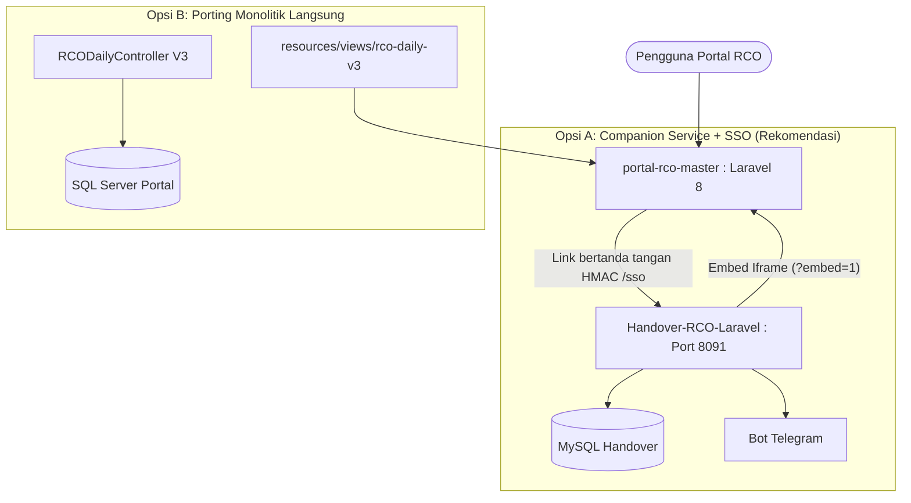

# Panduan Integrasi: Handover RCO ke Portal RCO Master

Dokumen ini berisi analisis menyeluruh terhadap arsitektur **`portal-rco-master`** dan panduan teknis langkah demi langkah untuk mengintegrasikan / mendeploy modul **`Handover-RCO-Laravel`** ke dalam Portal RCO.

---

## Daftar Isi

1. [Gambaran Umum Proyek](#1-gambaran-umum-proyek)
2. [Bedah Arsitektur `portal-rco-master`](#2-bedah-arsitektur-portal-rco-master)
3. [Fitur Daily Issue yang Ada di Portal RCO (Eksisting)](#3-fitur-daily-issue-yang-ada-di-portal-rco-eksisting)
4. [Komparasi Fitur: Eksisting vs Handover Baru](#4-komparasi-fitur-eksisting-vs-handover-baru)
5. [Komparasi Skema Database](#5-komparasi-skema-database)
6. [Opsi Strategi Integrasi](#6-opsi-strategi-integrasi)
   - [Opsi A: Integrasi Companion Service via SSO & Iframe (Sangat Direkomendasikan)](#opsi-a-integrasi-companion-service-via-sso--iframe-sangat-direkomendasikan)
   - [Opsi B: Penggabungan Monolitik Langsung (Porting ke Laravel 8)](#opsi-b-penggabungan-monolitik-langsung-porting-ke-laravel-8)
7. [Panduan Langkah Demi Langkah: Opsi A (SSO / Iframe)](#7-panduan-langkah-demi-langkah-opsi-a-sso--iframe)
8. [Panduan Langkah Demi Langkah: Opsi B (Porting Monolitik)](#8-panduan-langkah-demi-langkah-opsi-b-porting-monolitik)
9. [Checklist Pengujian & Verifikasi](#9-checklist-pengujian--verifikasi)

---

## 1. Gambaran Umum Proyek

- **Host Utama (`portal-rco-master`)**: Web portal internal operasional RCO BRI yang menyediakan berbagai layanan administrasi, monitoring rekon, job management, dan daily checklist.
- **Fitur Baru (`Handover-RCO-Laravel`)**: Modul Daily Issue interaktif modern yang dilengkapi pencatatan issue oleh Polisi, penanganan oleh Engineer, follow-up tracker, multi-attachment (termasuk paste screenshot `Ctrl+V`), export Excel, sinkronisasi Google Spreadsheet, dan bot rekap Telegram.
- **Tujuan**: Membawa seluruh kapabilitas baru dari `Handover-RCO-Laravel` agar dapat diakses oleh personil RCO melalui `portal-rco-master`.

---

## 2. Bedah Arsitektur `portal-rco-master`

| Parameter | Spesifikasi Portal RCO Master |
| :--- | :--- |
| **Framework** | **Laravel 8.75** (`"laravel/framework": "^8.75"`) |
| **PHP Version** | `^7.3` atau `^8.0` |
| **Asset Tooling** | **Laravel Mix** (`webpack.mix.js`) |
| **Frontend UI** | **Bootstrap 5**, NiceAdmin template, jQuery, DataTables, Select2, SweetAlert2 |
| **Koneksi Database** | Multi-koneksi berbasis **Microsoft SQL Server**:<br>• `sqlsrv`: default database<br>• `sqlsrv2`: database `portalrco` (tempat tabel `users`, `menus`, `team`, `daily_issue`) |
| **Model Autentikasi** | Standard Laravel Session Auth (`auth()->user()`)<br>Field: `pn` (Personal Number), `nama`, `role`, `team_id`, `password` |
| **Struktur Navigasi** | Sidebar di [`resources/views/main/main.blade.php`](file:///c:/Users/ASUS/Documents/BRI/Deploy-Resource/portal-rco-master@8e23535e608/resources/views/main/main.blade.php) yang memadukan menu statis dan menu dinamis dari tabel `menus` & `role_menu` |

---

## 3. Fitur Daily Issue yang Ada di Portal RCO (Eksisting)

Portal RCO master saat ini telah memiliki dua versi Daily Issue:

1. **Daily Issue V1 (`/daily-issue`)**:
   - Controller: `RCODailyController@daily_issue`
   - Data diambil melalui raw SQL join (`daily_issue` join `mapping_aplikasi`, `master_ip`, `master_grup_aplikasi`, dan `users`).
   - Tampilan berbasis tabel DataTables standar dengan input issue manual.
2. **Daily Issue V2 (`/daily-issue-v2`)**:
   - Controller: `RCODailyController@daily_issue_v2`
   - Membagi issue ke dalam 3 tab URL:
     - `/daily-issue-v2`: Issue belum selesai
     - `/daily-issue-v2-onprogress`: Issue on progress
     - `/daily-issue-v2-completed`: Issue selesai
   - Aksi: `take_issue` (mengisi `pic_pn` dan set status ke *On Progress*) dan `complete_issue` (upload 1 file dokumentasi max 10MB).
   - Akses dibatasi ketat: `@if(auth()->user()->role == 'Super Admin' || auth()->user()->role == 'Admin')`.

---

## 4. Komparasi Fitur: Eksisting vs Handover Baru

| Fitur | Portal RCO (Eksisting V2) | Handover RCO Laravel (Baru) |
| :--- | :--- | :--- |
| **Dashboard & Rekap** | Tabel biasa per tab status | Card summary real-time (total, pending, on progress, trouble, done, follow-up) |
| **Panel Per Tim** | Tidak ada | Visual breakdown beban kerja per tim (Tim 1, 2, 3, ALL TEAM) |
| **Pencatatan Issue (Polisi)** | Modal form biasa | Auto-complete aplikasi & tim, status otomatis *Pending*, nomor urut bulanan otomatis |
| **Tindak Lanjut (Engineer)** | Form popup submit standar | Validasi wajib isi PIC, input waktu mulai/selesai, status On Progress/Trouble/Done/Other |
| **Lampiran / Bukti** | 1 file saat complete issue | **Multi-attachment** (hingga 10 file/gambar), drag-and-drop, dan **paste screenshot langsung (`Ctrl+V`)** |
| **Follow-up Tracker** | Tidak ada | Panel khusus untuk memantau issue yang tertunda/butuh perhatian lanjutan |
| **Filter & Pencarian** | Filter kolom tabel DataTables | Filter terpadu: Hari Ini, Kemarin, Minggu Ini, Bulan Ini, Bulan Lalu, custom range, status chip, dan search text |
| **Notifikasi Telegram** | Tidak ada | Tombol **Kirim ke Telegram** dengan modal pratinjau pesan, dan bot background command (`handover:bot`) |
| **Sinkronisasi Spreadsheet** | Tidak ada | Sinkronisasi dua arah / impor dari Google Sheets melalui Apps Script API |
| **Download Laporan** | Mengandalkan export DataTables biasa | **Export Excel native (.xlsx)** dengan header resmi dan penyesuaian kolom rapi tanpa dependensi berat |
| **Soft Delete** | Delete permanen | Soft delete dengan audit trail (mencatat `dihapus_oleh`) |

---

## 5. Komparasi Skema Database

### Skema Lama (`daily_issue` di Portal RCO - SQL Server `sqlsrv2`):
```sql
CREATE TABLE [dbo].[daily_issue] (
    [id] [bigint] IDENTITY(1,1) NOT NULL,
    [tgl_buat_issue] [datetime2](7) NULL,
    [issue] [nvarchar](max) NOT NULL,
    [pelapor] [nvarchar](150) NOT NULL,
    [media_laporan] [nvarchar](100) NOT NULL,
    [penerima_laporan] [nvarchar](150) NOT NULL,
    [pencatat_issue] [nvarchar](50) NOT NULL,    -- menyimpan PN user
    [waktu_issue] [datetime2](7) NOT NULL,
    [status] [nvarchar](50) NOT NULL,           -- 'Issue', 'On Progress', 'Complete'
    [pic_pn] [nvarchar](50) NULL,               -- menyimpan PN user
    [waktu_finish_issue] [datetime2](7) NULL,
    [note] [nvarchar](max) NULL,
    [aplikasi_id] [bigint] NULL,                -- relasi ke mapping_aplikasi
    [dokumentasi] [nvarchar](255) NULL,         -- path file tunggal
    [created_at] [datetime2](7) NULL,
    [updated_at] [datetime2](7) NULL
);
```

### Skema Baru (`daily_issues` di Handover RCO):
```sql
CREATE TABLE `daily_issues` (
    `id` bigint unsigned AUTO_INCREMENT PRIMARY KEY,
    `bulan` varchar(7) NULL,                     -- format 'YYYY-MM' untuk nomor urut
    `nomor` unsigned int NULL,                   -- nomor urut issue di bulan tsb (reset tiap bulan)
    `tanggal` date NOT NULL,
    `waktu_lapor` time NULL,
    `issue` text NOT NULL,
    `aplikasi` varchar(150) DEFAULT '',
    `team` varchar(20) DEFAULT 'ALL TEAM',
    `pelapor` varchar(150) DEFAULT '',
    `media_laporan` varchar(100) DEFAULT '',
    `penerima_laporan` varchar(150) DEFAULT '',
    `pencatat_issue` varchar(100) DEFAULT '',   -- menyimpan nama personil pencatat
    `status` varchar(20) DEFAULT 'pending',     -- 'pending', 'onprogress', 'trouble', 'other', 'done'
    `pic` varchar(100) DEFAULT '',              -- menyimpan nama engineer
    `waktu_mulai` time NULL,
    `tanggal_finish` date NULL,
    `waktu_selesai` time NULL,
    `note` text NULL,
    `aplikasi_ip` varchar(100) NULL,
    `dokumentasi` varchar(255) NULL,
    `follow_up` tinyint(1) DEFAULT 0,
    `sumber_tab` varchar(100) NULL,
    `sumber_baris` unsigned int NULL,
    `diubah_web_at` timestamp NULL,
    `dihapus_oleh` varchar(100) NULL,
    `deleted_at` timestamp NULL,
    `created_at` timestamp NULL,
    `updated_at` timestamp NULL
);

-- Tabel pendukung baru:
-- 1. lampiran (id, issue_id, nama_file, path, ukuran_byte, tipe_mime, diunggah_oleh, timestamps)
-- 2. aplikasi (id, nama, team, jumlah_issue, timestamps)
```

---

## 6. Opsi Strategi Integrasi



### Evaluasi Opsi

| Aspek | Opsi A (SSO / Embed Iframe) | Opsi B (Porting Monolitik) |
| :--- | :--- | :--- |
| **Kompatibilitas Versi** | **100% Aman**: `portal-rco-master` tetap di Laravel 8 / PHP 8.0, `Handover-RCO-Laravel` tetap di Laravel 12 / PHP 8.2+. | **Butuh Refactor**: Seluruh syntax PHP 8.2 & Laravel 12 harus diturunkan ke Laravel 8 / PHP 8.0. |
| **Resiko Regresi** | **Nol**: Kode Portal RCO master tidak beresiko error karena dependensi tidak tercampur. | **Sedang-Tinggi**: Perlu uji ulang package composer dan database migration. |
| **Waktu Implementasi** | **Cepat (< 1 jam)**: Cukup pasang route SSO dan link di sidebar. | **Lebih Lama**: Butuh konversi controller, model, migration, dan styling view. |
| **Infrastruktur** | Menjalankan 2 service (web server portal & service handover). | Menjalankan 1 web server terpusat. |

---

## 7. Panduan Langkah Demi Langkah: Opsi A (SSO / Iframe)

Strategi ini memanfaatkan arsitektur SSO HMAC-SHA256 yang sudah siap di `Handover-RCO-Laravel`.

### Langkah 1: Tentukan Secret Key Bersama
Jalankan perintah ini sekali untuk menghasilkan random secret string:
```bash
php -r "echo bin2hex(random_bytes(32));"
```
Contoh hasil: `4f7e2c98d6b1a03e7f5298d...`

### Langkah 2: Konfigurasi `.env` di `Handover-RCO-Laravel`
Tambahkan nilai konfigurasi berikut pada `.env` aplikasi Handover:
```env
PORTAL_SSO_SECRET=4f7e2c98d6b1a03e7f5298d...
PORTAL_URL=http://<ip-atau-domain-portal-rco>
PORTAL_ORIGIN=http://<ip-atau-domain-portal-rco>
```

### Langkah 3: Konfigurasi `.env` di `portal-rco-master`
Tambahkan konfigurasi berikut pada `.env` Portal RCO:
```env
DAILY_ISSUE_URL=http://<ip-server>:8091
DAILY_ISSUE_SSO_SECRET=4f7e2c98d6b1a03e7f5298d...
```

### Langkah 4: Tambahkan Route SSO di `portal-rco-master/routes/web.php`
Buka file `routes/web.php` di Portal RCO master, lalu tambahkan route di dalam group middleware `auth`:

```php
// Route SSO ke Handover Daily Issue Baru
Route::get('/daily-issue-v3', function () {
    $user = auth()->user();
    
    // Siapkan data user yang sudah login di portal
    $payload = [
        'username' => $user->pn,
        'nama' => $user->nama,
        'exp' => time() + 60, // Link berlaku 60 detik
    ];
    
    $data = base64_encode(json_encode($payload));
    $sig = hash_hmac('sha256', $data, config('services.daily_issue.sso_secret') ?? env('DAILY_ISSUE_SSO_SECRET'));
    
    $targetUrl = (config('services.daily_issue.url') ?? env('DAILY_ISSUE_URL')) . '/sso?' . http_build_query([
        'data' => $data,
        'sig' => $sig,
        'embed' => 1 // Menghilangkan navbar & sidebar Handover agar menyatu di portal
    ]);

    // Jika ingin ditampilkan langsung di dalam wrapper iframe portal:
    return view('rco-daily.daily-issue-v3-frame', ['iframeUrl' => $targetUrl]);
    
    // Atau jika ingin langsung redirect membuka tab penuh:
    // return redirect($targetUrl);
})->name('daily_issue_v3');
```

### Langkah 5: Buat View Wrapper di `portal-rco-master`
Buat file baru di `portal-rco-master/resources/views/rco-daily/daily-issue-v3-frame.blade.php`:

```blade
@extends('main.main')

@section('title', 'Portal RCO | Daily Issue & Handover')
@section('sub-title', 'Daily Issue RCO')

@section('content')
<div class="card shadow-sm border-0" style="border-radius: 12px; overflow: hidden;">
    <iframe src="{{ $iframeUrl }}" 
            style="width: 100%; height: calc(100vh - 160px); border: none;" 
            allow="clipboard-read; clipboard-write">
    </iframe>
</div>
@endsection
```

### Langkah 6: Tambahkan Menu di Sidebar `portal-rco-master`
Buka [`resources/views/main/main.blade.php`](file:///c:/Users/ASUS/Documents/BRI/Deploy-Resource/portal-rco-master@8e23535e608/resources/views/main/main.blade.php) pada bagian dropdown `Issue Management` (sekitar baris 253):

```blade
<li>
    <a class="{{ Request::is('daily-issue-v3*') ? 'bg-link-light rounded-end-pill active' : '' }}"
        href="/daily-issue-v3">
        <i class="bi bi-circle"></i><span>Daily Issue & Handover (Baru)</span>
    </a>
</li>
```

---

## 8. Panduan Langkah Demi Langkah: Opsi B (Porting Monolitik)

Jika Anda memutuskan untuk menyatukan seluruh file PHP ke dalam satu repository `portal-rco-master` (Laravel 8):

### Penyesuaian Syntax (PHP 8.2 / Laravel 12 -> PHP 8.0 / Laravel 8):
1. **Model Casts**:
   - *Laravel 12*: `protected function casts(): array { return [...]; }`
   - *Laravel 8*: Ganti menjadi properti klasik:
     ```php
     protected $casts = [
         'tanggal' => 'date:Y-m-d',
         'tanggal_finish' => 'date:Y-m-d',
         'follow_up' => 'boolean',
     ];
     ```
2. **Migration Anonymous Class**:
   - Ganti `return new class extends Migration` menjadi class bernama standar:
     ```php
     class CreateDailyIssuesTable extends Migration
     ```
3. **Database Driver**:
   - Jika tabel disimpan di database SQL Server (`sqlsrv2`):
     - Pastikan syntax `unsignedInteger`, `text`, dan `timestamp` di migration disesuaikan untuk SQL Server MSSQL.
     - Di model `DailyIssue`, `Lampiran`, dan `Aplikasi`, tambahkan:
       ```php
       protected $connection = 'sqlsrv2';
       ```
4. **Registrasi File Service & Helper**:
   - Copy folder `app/Handover` ke `app/Handover` di `portal-rco-master`.
   - Copy folder `app/Http/Controllers/Daily` ke `portal-rco-master`.
   - Register route API dan Controller di `routes/web.php` dan `routes/api.php`.
   - Pindahkan asset CSS/JS dari `public/static/` Handover ke `public/assets/` Portal RCO.

---

## 9. Checklist Pengujian & Verifikasi

Sebelum rilis ke seluruh tim RCO:

- [ ] **Login & SSO**: Buka `/daily-issue-v3` dari portal saat login. Pastikan nama dan PN otomatis terisi di sudut kanan atas dashboard issue.
- [ ] **Akses Tanpa Login**: Coba buka URL Handover langsung di browser tanpa token SSO (jika memakai Opsi A). Pastikan aplikasi menolak akses atau mengalihkan ke login portal.
- [ ] **Input Issue (Polisi)**:
  - Input issue baru dengan nama aplikasi terdaftar (cek apakah Tim otomatis terisi).
  - Paste screenshot gambar dari clipboard (`Ctrl+V`) ke dropzone lampiran.
  - Simpan dan pastikan nomor urut bulanan bertambah dari 1.
- [ ] **Tindak Lanjut (Engineer)**:
  - Buka issue berstatus Pending.
  - Isi nama PIC, tanggal mulai/selesai, status On Progress atau Done.
  - Simpan dan pastikan summary card status langsung terupdate.
- [ ] **Download Excel**: Unduh file rekap Excel dan buka menggunakan Microsoft Excel untuk memastikan format baris dan kolom tidak rusak.
- [ ] **Bot Telegram (Opsional)**:
  - Jalankan background worker `php artisan handover:bot`.
  - Ketik perintah `/rekap` di grup Telegram untuk memverifikasi data sinkron dengan dashboard web.
