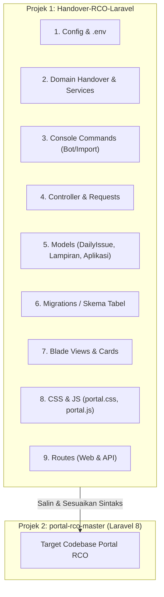

# Checklist Pemindahan: Dari `Handover-RCO-Laravel` ke `portal-rco-master`

Dokumen ini berisi **daftar lengkap (checklist)** file, konfigurasi, skema database, dan penyesuaian kode yang harus dipindahkan jika Anda ingin menggabungkan fitur **Handover RCO** (Projek 1) langsung ke dalam **Portal RCO Master** (Projek 2).

---

## Ringkasan Kategori yang Dipindah



---

## 1. Konfigurasi & Environment

### A. File Konfigurasi Baru
Salin file konfigurasi domain Handover:
- **Dari:** `config/handover.php`
- **Ke:** `portal-rco-master/config/handover.php`

### B. Variabel `.env` yang Harus Ditambahkan ke `portal-rco-master/.env`
Tambahkan baris-baris berikut ke dalam `.env` portal master:
```env
# ========================================================
# HANDOVER RCO & DAILY ISSUE
# ========================================================
TELEGRAM_BOT_TOKEN=                       # Token bot dari @BotFather
APPS_SCRIPT_URL=                          # URL Web App Apps Script (hanya aksi baca)
APPS_SCRIPT_KEY=                          # Secret key Apps Script
SPREADSHEET_ID=1lmIgK_GMZaeRUUc0Ea_K31jpRAn_P_PifWsm5PvjJsw
ALLOWED_CHAT_IDS=                         # ID chat/grup Telegram yang diizinkan (pisahkan koma)
HANDOVER_TIMEZONE=Asia/Jakarta
REPORT_TITLE="Handover Polisi – Team RCO"

# Tujuan tombol "Kirim ke Telegram" di web
WEB_CHAT_ID=                              # ID grup tujuan kirim rekap
WEB_LINK_TARGET=asli
TRANSIT_SPREADSHEET_ID=1UK5iVxAi8ROiUHGIjGeMLeMZAOUAh-nRRb75eb3F59A
```

---

## 2. Domain Handover & Service (`app/`)

### A. Domain Rekap & Logika Inti (`app/Handover/`)
Salin **seluruh folder** `app/Handover/` (29 file) ke `portal-rco-master/app/Handover/`:
- [ ] `app/Handover/Category.php`
- [ ] `app/Handover/ColumnMap.php`
- [ ] `app/Handover/CommandError.php`
- [ ] `app/Handover/Commands.php` (parser format perintah bot & rentang tanggal)
- [ ] `app/Handover/Dates.php` (parser tanggal bahasa Indonesia & serial Excel)
- [ ] `app/Handover/DbIssueProvider.php`
- [ ] `app/Handover/Issue.php`
- [ ] `app/Handover/IssueProvider.php`
- [ ] `app/Handover/IssueService.php` (pemilih tab spreadsheet, penggabung, filter)
- [ ] `app/Handover/Py.php` (helper kompatibilitas perilaku string Python)
- [ ] `app/Handover/Query.php`
- [ ] `app/Handover/RawRow.php`
- [ ] `app/Handover/RawSheet.php`
- [ ] `app/Handover/Report.php` (generator format pesan HTML rekap Telegram)
- [ ] `app/Handover/Rules.php` (deteksi warna, tim, sanitasi nama PIC)
- [ ] `app/Handover/Teams.php`
- [ ] `app/Handover/Telegram.php` (HTTP client Bot API Telegram)
- [ ] `app/Handover/TelegramError.php`
- [ ] `app/Handover/Bot/HandoverBot.php` (handler perintah bot Telegram)
- [ ] `app/Handover/Export/XlsxWriter.php` (generator file Excel native tanpa dependensi berat)
- [ ] `app/Handover/Import/SheetImporter.php`
- [ ] `app/Handover/Sources/AppsScriptSource.php` (sumber data read-only Google Sheets)
- [ ] `app/Handover/Sources/Source.php`
- [ ] `app/Handover/Sources/SourceError.php`
- [ ] `app/Handover/Web/HandoverWeb.php` (generator pratinjau rekap web)
- [ ] `app/Handover/Web/WebError.php`

### B. Service Harian (`app/Services/Daily/`)
Salin folder `app/Services/Daily/` ke `portal-rco-master/app/Services/Daily/`:
- [ ] `app/Services/Daily/ExportExcel.php` (generator export rekap Excel harian)
- [ ] `app/Services/Daily/SimpanLaporan.php` (service parser input & relasi lampiran)

---

## 3. Console Commands Artisan (`app/Console/Commands/`)

Salin perintah command agar bot Telegram dan script impor tetap bisa berjalan di server:
- [ ] **Dari:** `app/Console/Commands/HandoverBotCommand.php`  
  **Ke:** `portal-rco-master/app/Console/Commands/HandoverBotCommand.php`  
  *(Perintah: `php artisan handover:bot`)*
- [ ] **Dari:** `app/Console/Commands/HandoverImportCommand.php`  
  **Ke:** `portal-rco-master/app/Console/Commands/HandoverImportCommand.php`  
  *(Perintah: `php artisan handover:import`)*
- [ ] **Dari:** `app/Console/Commands/HandoverRekapCommand.php`  
  **Ke:** `portal-rco-master/app/Console/Commands/HandoverRekapCommand.php`  
  *(Perintah: `php artisan handover:rekap`)*

---

## 4. Controllers & Form Requests

### A. Controller Daily Issue (`app/Http/Controllers/Daily/`) *(Sudah Dirapikan & Modular!)*
Hanya tersisa 4 controller yang terstruktur rapi:
- [ ] `app/Http/Controllers/Daily/DailyIssueController.php` (Pusat siklus hidup issue: view halaman, CRUD polisi, tindak lanjut engineer, follow-up tracker, dan rekomendasi aplikasi)
- [ ] `app/Http/Controllers/Daily/ExportController.php` (Khusus render & unduh file Excel)
- [ ] `app/Http/Controllers/Daily/LampiranController.php` (Khusus stream & unduh file lampiran)
- [ ] `app/Http/Controllers/Daily/SyncController.php` (Khusus sinkronisasi Google Spreadsheet)

### B. Controller Handover Telegram
- [ ] **Dari:** `app/Http/Controllers/HandoverController.php`  
  **Ke:** `portal-rco-master/app/Http/Controllers/HandoverController.php`  
  *(Menangani pratinjau rekap dan kirim langsung ke Telegram)*

### C. Form Requests (`app/Http/Requests/Daily/`)
Salin seluruh file validasi request ke `portal-rco-master/app/Http/Requests/Daily/`:
- [ ] `app/Http/Requests/Daily/DailyRequest.php`
- [ ] `app/Http/Requests/Daily/FollowUpRequest.php`
- [ ] `app/Http/Requests/Daily/PeriodeRequest.php`
- [ ] `app/Http/Requests/Daily/SimpanIssueRequest.php`
- [ ] `app/Http/Requests/Daily/TindakLanjutRequest.php`

### D. API Resources (`app/Http/Resources/`) *(Baru & Rapi!)*
Salin file transformasi respons JSON:
- [ ] **Dari:** `app/Http/Resources/DailyIssueResource.php`  
  **Ke:** `portal-rco-master/app/Http/Resources/DailyIssueResource.php`
- [ ] **Dari:** `app/Http/Resources/LampiranResource.php`  
  **Ke:** `portal-rco-master/app/Http/Resources/LampiranResource.php`

---

## 5. Middleware (`app/Http/Middleware/`)

- [ ] **Salin:** `app/Http/Middleware/RequireJson.php` ke `portal-rco-master/app/Http/Middleware/RequireJson.php`
- [ ] **Daftarkan di:** `portal-rco-master/app/Http/Kernel.php` pada bagian `$routeMiddleware`:
  ```php
  'require.json' => \App\Http\Middleware\RequireJson::class,
  ```

*(Catatan: `PortalLogin.php` dan `WebPassword.php` dari Projek 1 **tidak perlu disalin**, karena pengguna portal sudah wajib melewati middleware `auth` bawaan Portal RCO).*

---

## 6. Models (`app/Models/`)

### A. Model Baru yang Harus Ditambahkan
- [ ] **Model Lampiran:**  
  Salin `app/Models/Lampiran.php` ke `portal-rco-master/app/Models/Lampiran.php`.
- [ ] **Model Aplikasi:**  
  Salin `app/Models/Aplikasi.php` ke `portal-rco-master/app/Models/Aplikasi.php`.

### B. Penanganan Model `DailyIssue.php`
> [!WARNING]
> Di `portal-rco-master` **sudah ada** file [`app/Models/DailyIssue.php`](file:///c:/Users/ASUS/Documents/BRI/Deploy-Resource/portal-rco-master@8e23535e608/app/Models/DailyIssue.php) yang dipakai oleh Daily Issue V1 dan V2 lama.

Pilih salah satu solusi berikut:
- **Solusi Rekomendasi (Aman & Tidak Merusak V1/V2):**  
  Simpan model baru di namespace terpisah:  
  `portal-rco-master/app/Models/Daily/DailyIssue.php` (atau beri nama `HandoverDailyIssue.php`), lalu arahkan controller di folder `Daily` untuk memakai model ini.
- **Solusi Upgrade (Menggantikan V1/V2):**  
  Mengganti isi `app/Models/DailyIssue.php` lama, dengan catatan view Daily Issue V1/V2 lama dinonaktifkan dan diganti sepenuhnya oleh versi baru.

---

## 7. Skema Database & Migrasi

Jika tabel baru disimpan di database SQL Server portal (`sqlsrv2`):

### A. 3 File Migrasi Bersih (Sudah Disatukan/Clean)
Migrasi di projek Handover sudah disatukan menjadi 3 file migrasi bersih (tanpa patch berulang):
1. **`2026_11_05_000001_create_daily_issues_table.php`** (Mencakup seluruh field issue, follow-up, soft deletes, nomor bulanan, note, IP, dokumentasi).
2. **`2026_11_05_000002_create_lampiran_table.php`** (Multi-attachment foto & dokumen).
3. **`2026_11_05_000003_create_aplikasi_table.php`** (Rekomendasi nama aplikasi & tim).

### B. Migrasi Laravel 8
Salin migrasi dari `database/migrations/` Projek 1 ke Projek 2, dan sesuaikan sintaksnya dari anonymous migration (`return new class extends Migration`) menjadi format Laravel 8 klasik:
```php
class CreateDailyIssuesTable extends Migration
{
    public function up()
    {
        Schema::connection('sqlsrv2')->create('daily_issues', function (Blueprint $table) {
            // Kolom tabel...
        });
    }
    
    public function down()
    {
        Schema::connection('sqlsrv2')->dropIfExists('daily_issues');
    }
}
```

---

## 8. Frontend Views (`resources/views/`)

### A. File View Utama & Komponen Card
Salin folder view dari `Handover-RCO-Laravel`:
- [ ] **Dari:** `resources/views/daily.blade.php`  
  **Ke:** `portal-rco-master/resources/views/rco-daily/daily-issue-v3.blade.php`
- [ ] **Salin seluruh folder card:**  
  **Dari:** `resources/views/daily/cards/`  
  **Ke:** `portal-rco-master/resources/views/rco-daily/cards/`
  - `filters.blade.php`
  - `follow-up.blade.php`
  - `issues.blade.php`
  - `summary.blade.php`
  - `teams.blade.php`

### B. Penyesuaian Layout View
Pada file `daily-issue-v3.blade.php`:
- Ubah baris pertama `@extends('layouts.portal')` menjadi:
  ```blade
  @extends('main.main')
  
  @section('title', 'Portal RCO | Daily Issue & Handover')
  @section('sub-title', 'Daily Issue RCO')
  ```
- Masukkan stylesheet dan script pendukung ke section `@section('content')` atau stack `@push('styles')`.

---

## 9. Static Assets (CSS & JS)

Salin file asset frontend dari `public/static/`:
- [ ] **Dari:** `public/static/css/portal.css`  
  **Ke:** `portal-rco-master/public/assets/css/daily-handover.css` (atau tetap `public/static/css/portal.css`)
- [ ] **Dari:** `public/static/js/portal.js`  
  **Ke:** `portal-rco-master/public/assets/js/daily-handover.js` (atau tetap `public/static/js/portal.js`)
- [ ] **Ikon/SVG:** Salin aset SVG yang ada di `public/static/` jika diperlukan.

---

## 10. Routing (`routes/web.php`)

Tambahkan route baru di dalam grup middleware `['auth']` pada file `portal-rco-master/routes/web.php`:

```php
use App\Http\Controllers\Daily\DailyIssueController;
use App\Http\Controllers\Daily\ExportController;
use App\Http\Controllers\Daily\LampiranController;
use App\Http\Controllers\Daily\SyncController;
use App\Http\Controllers\HandoverController;

Route::group(['middleware' => ['auth']], function () {
    
    // ==========================================
    // DAILY ISSUE & HANDOVER (FITUR BARU)
    // ==========================================
    Route::get('/daily-issue-v3', [DailyIssueController::class, 'halaman'])->name('daily_issue_v3');

    Route::prefix('api/daily')->group(function () {
        // Kirim rekap Telegram
        Route::get('/config', [HandoverController::class, 'config']);
        Route::post('/preview', [HandoverController::class, 'preview']);
        Route::post('/send', [HandoverController::class, 'send']);

        // Siklus hidup Daily Issue (Polisi & Engineer)
        Route::controller(DailyIssueController::class)->group(function () {
            // Laporan polisi
            Route::get('/issues', 'index');
            Route::post('/issues', 'store');
            Route::get('/issues/{issue}', 'show');
            Route::post('/issues/{issue}', 'update');
            Route::delete('/issues/{issue}', 'destroy');

            // Tindak lanjut engineer
            Route::match(['PUT', 'POST'], '/issues/{issue}/tindak-lanjut', 'tindakLanjut');

            // Follow-Up
            Route::get('/follow-ups', 'followUps');
            Route::put('/issues/{issue}/follow-up', 'toggleFollowUp');

            // Rekomendasi nama aplikasi
            Route::get('/aplikasi', 'aplikasi');
        });

        // Specialized Controllers: Lampiran, Export, dan Sync
        Route::get('/lampiran/{lampiran}', [LampiranController::class, 'show']);
        Route::get('/export', ExportController::class);
        Route::post('/sync', SyncController::class);
    });
});
```

---

## 11. Penambahan Menu Sidebar

Buka file [`portal-rco-master/resources/views/main/main.blade.php`](file:///c:/Users/ASUS/Documents/BRI/Deploy-Resource/portal-rco-master@8e23535e608/resources/views/main/main.blade.php) pada bagian dropdown `Issue Management` (sekitar baris 255), lalu tambahkan link menu baru:

```blade
<li>
    <a class="{{ Request::is('daily-issue-v3*') ? 'bg-link-light rounded-end-pill active' : '' }}"
        href="{{ route('daily_issue_v3') }}">
        <i class="bi bi-circle"></i><span>Daily Issue & Handover</span>
    </a>
</li>
```

---

## 12. Penyesuaian Kompatibilitas Kode (Laravel 12 -> Laravel 8)

Ada beberapa perbedaan sintaks antara Laravel 12 (Projek 1) dan Laravel 8 (Projek 2) yang wajib disesuaikan:

| Komponen | Sintaks di Projek 1 (Laravel 12) | Sintaks Wajib di Projek 2 (Laravel 8) |
| :--- | :--- | :--- |
| **Model Casts** | `protected function casts(): array { return [...]; }` | `protected $casts = [ 'tanggal' => 'date:Y-m-d', ... ];` |
| **Koneksi Database** | Default koneksi MySQL | Tambahkan `protected $connection = 'sqlsrv2';` pada Model jika tabel ada di database SQL Server `portalrco`. |
| **Auto Pencatat Issue** | Input manual / session SSO | Otomatis isi dari user login portal: `auth()->user()->nama` dan `auth()->user()->pn`. |
| **Route Model Binding** | Resolusi implisit di `bootstrap/app.php` | Daftarkan explicit binding di `app/Providers/RouteServiceProvider.php` jika parameter `{issue}` menggunakan ID numerik. |
| **Storage Lampiran** | `storage/app/lampiran/` | Pastikan symlink storage aktif: `php artisan storage:link`. |

---

## 13. Urutan Eksekusi Pemindahan (Run-Order)

1. [ ] **Salin File Backend**: Salin folder `app/Handover`, `app/Services/Daily`, `app/Console/Commands`, `app/Http/Controllers/Daily`, `app/Http/Requests/Daily`, dan `config/handover.php`.
2. [ ] **Sesuaikan Model & Syntax**: Pastikan casts di Model menggunakan `protected $casts`.
3. [ ] **Migrasi Database**: Buat tabel `daily_issues`, `lampiran`, dan `aplikasi` di database SQL Server `portalrco`.
4. [ ] **Salin Asset & View**: Pindahkan view card ke `resources/views/rco-daily/` dan file CSS/JS ke folder `public/`.
5. [ ] **Daftarkan Route & Menu**: Tambahkan route di `web.php` dan link menu di `main.blade.php`.
6. [ ] **Isi `.env`**: Masukkan token Telegram dan konfigurasi Apps Script di `.env`.
7. [ ] **Uji Coba**:
   - Buka `/daily-issue-v3` di browser.
   - Input issue baru + paste screenshot `Ctrl+V`.
   - Update tindak lanjut engineer.
   - Tes export file Excel.
   - Jalankan `php artisan handover:bot` di terminal untuk mengetes bot Telegram.
