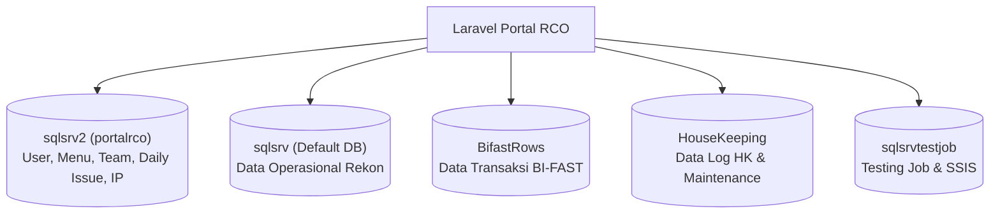

# Dokumentasi Lengkap: Web Portal RCO Master (`portal-rco-master`)

Dokumen ini menjelaskan secara menyeluruh tentang sistem **Web Portal RCO Master** (`portal-rco-master` @commit `8e23535e608`), mulai dari arsitektur sistem, basis data, mekanisme autentikasi dan hak akses, modul-modul fitur operasional, hingga alur routing dan views.

---

## Daftar Isi

1. [Gambaran Umum](#1-gambaran-umum)
2. [Spesifikasi & Tech Stack](#2-spesifikasi--tech-stack)
3. [Arsitektur Database & Multi-Koneksi](#3-arsitektur-database--multi-koneksi)
4. [Autentikasi & Role-Based Access Control (RBAC)](#4-autentikasi--role-based-access-control-rbac)
5. [Peta Fitur & Modul Aplikasi](#5-peta-fitur--modul-aplikasi)
   - [A. Manajemen Pengguna & Sistem](#a-manajemen-pengguna--sistem)
   - [B. IP & Application Management](#b-ip--application-management)
   - [C. Issue Management & Checklist](#c-issue-management--checklist)
   - [D. Rekonsiliasi & Patching Data (Core RCO)](#d-rekonsiliasi--patching-data-core-rco)
   - [E. Server & Job Management (SSIS & Task Scheduler)](#e-server--job-management-ssis--task-scheduler)
   - [F. RCO Drive (Manajemen Dokumen)](#f-rco-drive-manajemen-dokumen)
   - [G. Event iRIS (Agent & Log Monitoring)](#g-event-iris-agent--log-monitoring)
   - [H. Notifikasi & Monitoring (SMS/WA/Email)](#h-notifikasi--monitoring-smswaemail)
6. [Struktur Direktori & Alur Kode](#6-struktur-direktori--alur-kode)
7. [Tampilan Antarmuka & Layouting](#7-tampilan-antarmuka--layouting)
8. [Karakteristik & Catatan Teknis Penting](#8-karakteristik--catatan-teknis-penting)

---

## 1. Gambaran Umum

**Portal RCO Master** adalah portal web internal operasional yang digunakan oleh tim **RCO (Reconciliation Center Operation) BRI**. 

Portal ini berfungsi sebagai pusat komando operasional (*single point of operations*) untuk:
- Mengelola data operasional rekonsiliasi transaksi perbankan nasional (BI-FAST, ATM, QRIS, BRIZZI, MPAYS, EBOR, dll.).
- Memantau job SSIS dan Task Scheduler pada berbagai server database produksi.
- Menjalankan patching data transaksi operator telekomunikasi (Telkomsel, Indosat, XL, Smartfren, Tri).
- Mengelola checklist harian personil dan issue harian operasional.
- Menyediakan penyimpanan dokumen bersama tim RCO (RCO Drive).

---

## 2. Spesifikasi & Tech Stack

| Komponen | Spesifikasi / Library | Keterangan |
| :--- | :--- | :--- |
| **Framework Backend** | **Laravel Framework 8.75** | PHP versi `^7.3` atau `^8.0` |
| **Database Server** | **Microsoft SQL Server (MSSQL)** | Menggunakan ekstensi driver `pdo_sqlsrv` |
| **Authentication** | Standard Laravel Session (`Auth::attempt`) | Login menggunakan Personal Number (`pn`) & `password` |
| **Asset Tooling** | **Laravel Mix** (`webpack.mix.js`) | Kompilasi CSS & JS klasik berbasis Webpack |
| **CSS Framework** | **Bootstrap 5.x** (NiceAdmin Theme) | Bootstrap Icons, Boxicons, Remixicon, Simple-DataTables |
| **Tabel & Interaktivitas** | **jQuery + jQuery DataTables + Select2** | Ajax setup otomatis terinjeksi token CSRF |
| **Alert / Dialog** | **RealRashid / SweetAlert-2** (`realrashid/sweet-alert: ^7.1`) | Notifikasi pop-up sukses/gagal di session |
| **PDF Export** | **Barryvdh / Laravel-DomPDF** | Kompilasi dokumen PDF operasional |

---

## 3. Arsitektur Database & Multi-Koneksi

Portal RCO menggunakan arsitektur multi-database berbasis Microsoft SQL Server yang dikonfigurasi pada [`config/database.php`](file:///c:/Users/ASUS/Documents/BRI/Deploy-Resource/portal-rco-master@8e23535e608/config/database.php):



### Daftar Koneksi Database Utama:

1. **`sqlsrv2` (Database `portalrco`)**:
   - Merupakan database inti portal web.
   - Menyimpan tabel: `users`, `team`, `menus`, `role_menu`, `daily_issue`, `daily_checklists`, `master_ip`, `master_grup_aplikasi`, `mapping_aplikasi`, dll.
   - Sebagian besar Model Laravel mendefinisikan: `protected $connection = 'sqlsrv2';`
2. **`sqlsrv` (Database Utama Rekon)**:
   - Database default untuk transaksi umum dan inquiry sistem.
3. **`BifastRows`**:
   - Digunakan khusus oleh `BifastController` untuk menganalisis rasio file BI-FAST dan pelaporan settlement transaksi.
4. **`HouseKeeping`**:
   - Digunakan oleh `HouseKeepingController` untuk mencatat log maintenance tabel dan parameter credentials database server target.
5. **`sqlsrvtestjob`**:
   - Digunakan untuk monitoring dan eksekusi job SQL Server Agent.

---

## 4. Autentikasi & Role-Based Access Control (RBAC)

### A. Alur Login ([`LoginController.php`](file:///c:/Users/ASUS/Documents/BRI/Deploy-Resource/portal-rco-master@8e23535e608/app/Http/Controllers/LoginController.php))
1. Pengguna membuka halaman awal (`/`) yang diarahkan ke view `login.login`.
2. Input login berupa:
   - **`pn`**: Personal Number pekerja BRI.
   - **`password`**: Password akun (bcrypt/hashed).
3. Validasi tim: Jika pengguna berhasil diverifikasi tetapi belum terdaftar dalam suatu tim (`$user->team == null`), pengguna diarahkan ke tampilan error `login.gagal`.
4. Jika valid, session di-regenerate dan diarahkan ke `/home` ([`DashboardController.php`](file:///c:/Users/ASUS/Documents/BRI/Deploy-Resource/portal-rco-master@8e23535e608/app/Http/Controllers/DashboardController.php)).

### B. Struktur Hak Akses (RBAC)
Sistem hak akses di Portal RCO menggabungkan dua lapis:

1. **Pengecekan Level Role (`auth()->user()->role`)**:
   - `Super Admin`: Akses penuh ke seluruh menu sistem, manajemen pengguna, server job, dan konfigurasi IP.
   - `Admin`: Akses manajemen operasional dan fitur utama.
   - `User` / Anggota Tim: Dibatasi pada menu operasional timnya masing-masing.
2. **Mapping Menu Berbasis Tim (`role_menu`)**:
   - Model `Menu` terhubung ke tabel `menus`.
   - Model `RoleMenu` menghubungkan `team_id` dengan `menu_id`.
   - Di sidebar, menu-menu tertentu (seperti modul RE4 / Inquiry) di-filter secara dinamis:
     ```php
     $menu->role_menu->contains('team_id', auth()->user()->role_menu->team_id)
     ```

---

## 5. Peta Fitur & Modul Aplikasi

Di sidebar dan routing [`routes/web.php`](file:///c:/Users/ASUS/Documents/BRI/Deploy-Resource/portal-rco-master@8e23535e608/routes/web.php), Portal RCO Master mengelompokkan fiturnya ke dalam modul-modul berikut:

### A. Manajemen Pengguna & Sistem
- **User Management** (`/manage-users-index`): CRUD akun pengguna, asosiasi Personal Number (PN), hak role, dan penempatan tim kerja.
- **Team Management** (`/manage-team-index`): Kelola daftar tim operasional RCO.
- **Menu Management** (`/manage-menus-index`): Konfigurasi menu dinamis dan pemetaan hak akses per tim (`role_menu`).

### B. IP & Application Management
Mengatur inventaris server, host, dan aplikasi di lingkungan RCO:
- `/master-ip`: Daftar server IP host database dan aplikasi.
- `/master-grup-aplikasi`: Pengelompokan grup sistem (misal ESB, ATM, Rekon Core).
- `/master-aplikasi`: Mapping antara IP server, grup aplikasi, dan nama sistem.
- `/master-password`: Penyimpanan kredensial server terenkripsi.

### C. Issue Management & Checklist
- **Daily Issue V1 (`/daily-issue`)**: Pencatatan issue operasional harian terintegrasi dengan data master aplikasi dan user PN.
- **Daily Issue V2 (`/daily-issue-v2`)**: Sistem tracking issue tiga tahap (*Belum Selesai*, *On Progress*, *Selesai*), fitur ambil alih issue (`take_issue`) oleh PIC, dan penyelesaian issue (`complete_issue`) disertai upload bukti dokumentasi.
- **Daily Checklist (`/daily-checklist`)**: Daftar verifikasi checklist rutin personil operasional harian yang dapat di-generate otomatis setiap hari dari template (`/daily-checklist-template`).

### D. Rekonsiliasi & Patching Data (Core RCO)
Pusat eksekusi dan monitoring perbaikan data transaksi perbankan:
- **BI-FAST**:
  - `/rekonenterprise4/{id}/rasiofilebifast` & `rasiofilebifastv2`: Evaluasi rasio kelengkapan file transaksi BI-FAST.
  - `/SelfOtomationRecon/{id}/settlementbi-fast`: Retry settlement dan dorong pembukuan ke ESB (`dorcesb`).
- **Patching Operator Telekomunikasi**:
  - Endpoint update & koreksi status transaksi: Indosat (`/patching/{id}/indosat`), XL (`/patching/{id}/xl`), Smartfren (`/patching/{id}/smartfren`), dan Tri (`/patching/{id}/three`).
- **EBOR & MPAYS Batch**:
  - Manajemen eksekusi batch MPAYS, restart job generate QRIS Jalin dan QRIS Rintis.
- **Modul Lainnya**:
  - Inquiry MT940 (pencatatan dan regenerate log rekening koran), Rekon ATM, Leasing mingguan, TopUp Brizzi via WireCard, Validasi File transaksi.

### E. Server & Job Management (SSIS & Task Scheduler)
- **SSIS Job Management** (`/ServerJobManagement/{id}/jobmanagementssis`):
  - Memantau status paket SSIS (SQL Server Integration Services).
  - Melakukan start/stop job, toggle status aktif, dan sinkronisasi status job langsung ke server SQL.
- **Task Scheduler Management** (`/ServerJobManagement/{id}/jobmanagementtaskscheduler`):
  - Memantau dan mengontrol job Windows Task Scheduler di server remote.
- **Housekeeping Management** (`/HouseKeeping/{id}/paramhk`):
  - Monitoring kapasitas penyimpanan dan eksekusi rutin pembersihan tabel database historis.

### F. RCO Drive (Manajemen Dokumen)
Fitur penyimpanan dokumen internal mirip Google Drive ([`RcoDriveController.php`](file:///c:/Users/ASUS/Documents/BRI/Deploy-Resource/portal-rco-master@8e23535e608/app/Http/Controllers/RCODriveController.php)):
- **Hierarki Folder**: Buat folder, navigasi subfolder, ganti nama, dan hapus.
- **File Management**: Upload file, preview inline, download file, dan rename.
- **Trash & Recycle Bin**: File atau folder yang dihapus masuk ke `/trash` dan dapat di-restore atau di-force delete.
- **Favorite System**: Bookmark file/dokumen penting ke halaman `/favorite`.

### G. Event iRIS (Agent & Log Monitoring)
Modul monitoring anomali dan integrasi event:
- `/event-iris`: Log aktivitas penangkapan event anomali sistem.
- `/event-iris/event-variable-management`: Konfigurasi variabel kriteria penangkap log.
- `/event-iris/event-catcher-by-query-agent`: Pengujian parameter query terhadap log database untuk menembakkan alert ke agent OpsVision.

### H. Notifikasi & Monitoring (SMS/WA/Email)
- Log pengiriman SMS Notifikasi BRI Gold (`BRIGoldSMS63`, `BRIGoldSMS181`).
- Log pengiriman Email Notifikasi BRI Gold (`BRIGoldEmail181`).
- Pendaftaran parameter penerima alert WhatsApp/SMS.

---

## 6. Struktur Direktori & Alur Kode

```
portal-rco-master/
├── app/
│   ├── Http/
│   │   ├── Controllers/        # 50+ controller menangani setiap modul rekonsiliasi & operasional
│   │   │   ├── LoginController.php
│   │   │   ├── DashboardController.php
│   │   │   ├── RCODailyController.php          # Daily Issue V1 & V2
│   │   │   ├── RCODailyChecklistController.php # Daily Checklist
│   │   │   ├── RCODriveController.php          # RCO Drive
│   │   │   ├── ServerJobSSISManagementController.php
│   │   │   └── ...
│   │   └── Kernel.php          # Middleware stack Laravel 8
│   └── Models/                 # 39 model Eloquent (sebagian besar terhubung ke sqlsrv2)
│       ├── User.php            # Akun personil (PN, nama, role, team_id)
│       ├── Team.php            # Daftar tim operasional
│       ├── Menu.php & RoleMenu.php # RBAC dinamis
│       ├── DailyIssue.php      # Model issue eksisting
│       └── ...
├── config/
│   ├── database.php            # Konfigurasi multi-koneksi MSSQL (sqlsrv, sqlsrv2, BifastRows, dll.)
│   └── app.php
├── database/
│   ├── migrations/             # Migrasi dasar (users, menus, role_menu, team)
│   └── database.sql            # Script DDL SQL Server untuk inisialisasi awal database
├── resources/
│   └── views/
│       ├── main/
│       │   └── main.blade.php  # Layout induk (Header, Sidebar NiceAdmin, Profile Dropdown)
│       ├── login/              # Halaman form login & gagal login
│       ├── rco-daily/          # View blade Daily Issue V1 dan V2
│       ├── rco-daily-checklist/# View blade Daily Checklist
│       ├── rco-drive/          # View blade explorer dokumen RCO Drive
│       └── index.blade.php     # Dashboard utama saat login (/home)
├── routes/
│   ├── web.php                 # Seluruh deklarasi endpoint web aplikasi (~373 baris)
│   └── api.php
└── webpack.mix.js              # Script kompilasi Laravel Mix
```

---

## 7. Tampilan Antarmuka & Layouting

Layout utama didefinisikan pada [`resources/views/main/main.blade.php`](file:///c:/Users/ASUS/Documents/BRI/Deploy-Resource/portal-rco-master@8e23535e608/resources/views/main/main.blade.php):

1. **Header Atas (Topbar)**:
   - Logo portal `PortalRCO` dengan tombol toggle sidebar (`toggle-sidebar-btn`).
   - Profil pengguna di pojok kanan: Menampilkan nama (`auth()->user()->nama`), Personal Number (`auth()->user()->pn`), link `My Profile`, dan tombol `Sign Out`.
2. **Sidebar Kiri**:
   - Input pencarian menu cepat (`#menuSearch`) berbasis filter teks jQuery.
   - Menu berjenjang menggunakan collapsible accordion Bootstrap 5.
   - Pengecekan izin menu langsung di Blade dengan mengecek variabel `$menus` dan properti `auth()->user()->role`.
3. **Container Konten**:
   - Membaca section `@yield('content')`.
   - Menggunakan SweetAlert2 via `@include('sweetalert::alert')` untuk memunculkan flash popup setelah form submit.

---

## 8. Karakteristik & Catatan Teknis Penting

Sebelum melakukan modifikasi atau penambahan fitur baru pada Portal RCO Master, perhatikan hal-hal berikut:

1. **Kompatibilitas Versi PHP**:
   - Kode aplikasi menggunakan standar PHP 7.4 / 8.0.
   - Dependensi composer belum mendukung fitur-fitur baru PHP 8.2+ (seperti `readonly classes`, `dnf types`, dll.).
2. **Kueri SQL Server Langsung (Raw SQL)**:
   - Beberapa controller (seperti `RCODailyController@daily_issue`) mengeksekusi raw query `DB::connection('sqlsrv2')->select("SELECT di.*, mi.ip_address ...")` yang menggunakan sintaks spesifik T-SQL (seperti `CONVERT(DATE, GETDATE())`).
3. **Limitasi Query pada Data Besar**:
   - Pada fitur `daily_issue_v2`, diterapkan `limit(200)` untuk mencegah query timeout saat mengambil data dari database server produksi.
4. **Keamanan Upload File**:
   - Upload dokumen (misalnya bukti di `complete_issue` dan RCO Drive) disimpan di path publik `public/uploads/` dengan validasi ekstensi dan batas ukuran file maksimal 10 MB.
5. **Session Timeout & Error Handling**:
   - Halaman error khusus disiapkan di `/error403` dan `/logout404` untuk menangani sesi kedaluwarsa atau akses menu tanpa izin.
