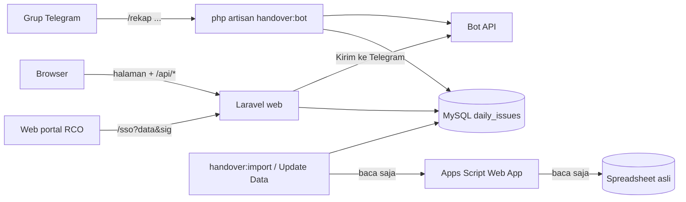
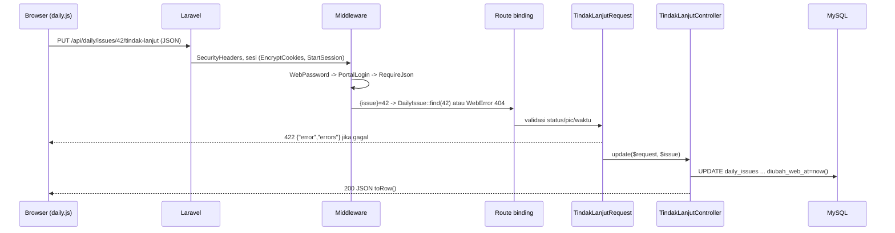

# Dokumentasi Teknis – Handover RCO (Laravel)

Dokumen ini menjelaskan **cara kerja kode** proyek ini, dari request masuk sampai data tersimpan di database dan
pesan terkirim ke Telegram. Cara instalasi dan menjalankan ada di [README.md](../README.md); dokumen ini fokus ke
"kenapa dan bagaimana" kodenya bekerja.

Setiap bagian menyebut konsep Laravel yang dipakai (middleware, route model binding, Form Request, Eloquent, dst.)
supaya kodenya bisa dipahami walau sudah lama tidak memakai Laravel.

---

## Daftar isi

1. [Gambaran umum](#1-gambaran-umum)
2. [Teknologi dan dependensi](#2-teknologi-dan-dependensi)
3. [Struktur folder](#3-struktur-folder)
4. [Siklus hidup sebuah request](#4-siklus-hidup-sebuah-request)
5. [Konfigurasi](#5-konfigurasi)
6. [Routing dan daftar endpoint](#6-routing-dan-daftar-endpoint)
7. [Middleware dan keamanan](#7-middleware-dan-keamanan)
8. [Database: tabel dan migrasi](#8-database-tabel-dan-migrasi)
9. [Model Eloquent](#9-model-eloquent)
10. [Controller, Form Request, dan Service](#10-controller-form-request-dan-service)
11. [Domain rekap (`app/Handover`)](#11-domain-rekap-apphandover)
12. [Impor dan sinkron dari spreadsheet](#12-impor-dan-sinkron-dari-spreadsheet)
13. [Bot Telegram dan perintah Artisan](#13-bot-telegram-dan-perintah-artisan)
14. [Export Excel tanpa library](#14-export-excel-tanpa-library)
15. [Frontend (Blade + JavaScript)](#15-frontend-blade--javascript)
16. [Pengujian](#16-pengujian)
17. [Alur lengkap: contoh kasus](#17-alur-lengkap-contoh-kasus)
18. [Catatan teknis dan hal yang perlu diperhatikan](#18-catatan-teknis-dan-hal-yang-perlu-diperhatikan)

---

## 1. Gambaran umum

Aplikasi ini adalah **Daily Issue RCO**: tempat tim mencatat dan menindaklanjuti issue harian, lalu merekapnya ke
grup Telegram dengan format *Handover Polisi – Team RCO*. Ada dua peran:

| Peran        | Yang dikerjakan                                                                                       |
| ------------ | ----------------------------------------------------------------------------------------------------- |
| **Polisi**   | Mencatat issue baru (status otomatis *Pending*), mengedit, menghapus, menandai follow-up, kirim rekap ke Telegram |
| **Engineer** | Menindaklanjuti issue: mengisi status (*On Progress / Trouble / Done*), PIC, waktu, note, IP, dokumentasi |

Proyek ini adalah **porting** dari versi Python ([Handover-Bot-RCO](https://github.com/EkaPutra0856/Handover-Bot-RCO)),
dengan satu perbedaan besar: **sumber data utama sekarang database MySQL**, bukan spreadsheet. Spreadsheet asli
masih dibaca (read-only) untuk mengimpor issue lama dan menyinkronkan perubahan selama tim masih mencatat di sana.



Tiga cara masuk ke kode yang sama:

- **Web** (`php artisan serve` / Apache): halaman Daily Issue dan API JSON.
- **Bot Telegram** (`php artisan handover:bot`): proses yang terus berjalan, long polling ke Telegram.
- **CLI** (`handover:rekap`, `handover:import`): untuk tes dan impor data.

Ketiganya memakai kelas domain yang sama di `app/Handover`, sehingga pesan rekap dari bot, dari tombol web, dan dari
CLI selalu identik.

---

## 2. Teknologi dan dependensi

| Komponen        | Versi / keterangan                                                                 |
| --------------- | ---------------------------------------------------------------------------------- |
| PHP             | 8.2+ (memakai enum, readonly promoted properties, `match`, named arguments)        |
| Laravel         | 12 (struktur baru: tanpa `Kernel.php`, konfigurasi di `bootstrap/app.php`)         |
| Database        | MySQL 8 (produksi), SQLite in-memory (tes)                                         |
| Ekstensi PHP    | curl, mbstring, openssl, fileinfo, **zip** (untuk export Excel)                   |
| Frontend        | HTML Blade + CSS + JavaScript murni, **tanpa build step** (Vite tidak dipakai)    |
| Library tambahan | **Tidak ada.** HTTP memakai `Http` facade bawaan, Excel ditulis manual dengan `ZipArchive` |

Kenapa tanpa library tambahan (misalnya PhpSpreadsheet atau telegram-bot-sdk)? Supaya `composer install` ringan dan
semua perilaku bisa dikontrol persis sama dengan versi Python.

---

## 3. Struktur folder

Hanya folder yang diubah dari skeleton Laravel yang dijelaskan.

```
app/
├── Console/Commands/
│   ├── HandoverBotCommand.php      handover:bot     – loop long polling Telegram
│   ├── HandoverImportCommand.php   handover:import  – salin issue dari spreadsheet ke DB
│   └── HandoverRekapCommand.php    handover:rekap   – tes rekap di terminal
├── Handover/                       DOMAIN: logika rekap (porting dari Python)
│   ├── Category.php, Teams.php, Query.php, Issue.php, RawRow.php, RawSheet.php, ColumnMap.php
│   ├── Commands.php                parse "/rekap Oktober 2026" -> Query
│   ├── Dates.php                   tanggal Indonesia, serial tanggal Sheets
│   ├── Rules.php                   deteksi kolom, warna (HSV), tim, sanitasi PIC, klasifikasi
│   ├── IssueService.php            rekap langsung dari spreadsheet (dipakai importer & --sheet)
│   ├── IssueProvider.php           interface sumber issue untuk rekap
│   ├── DbIssueProvider.php         implementasi: baca tabel daily_issues
│   ├── Report.php                  susun pesan HTML Telegram + pecah per 3800 karakter
│   ├── Py.php                      meniru perilaku string Python supaya hasil identik
│   ├── Telegram.php, TelegramError.php   klien Bot API minimal
│   ├── Bot/HandoverBot.php         handler perintah Telegram
│   ├── Web/HandoverWeb.php         pratinjau & kirim rekap dari web
│   ├── Web/WebError.php            exception yang aman ditampilkan (render JSON sendiri)
│   ├── Sources/                    Source (interface), AppsScriptSource, SourceError
│   ├── Import/SheetImporter.php    spreadsheet -> baris daily_issues
│   └── Export/XlsxWriter.php       penulis .xlsx dengan ZipArchive
├── Http/
│   ├── Controllers/
│   │   ├── Controller.php          helper json() (UTF-8 tanpa escape, no-store)
│   │   ├── HandoverController.php  /healthz, /api/config, /api/preview, /api/send
│   │   ├── SsoController.php       /sso – masuk dari web portal
│   │   └── Daily/                  satu controller per tugas (Issue, TindakLanjut, FollowUp, ...)
│   ├── Middleware/                 WebPassword, PortalLogin, RequireJson, SecurityHeaders
│   └── Requests/Daily/             Form Request (validasi) per aksi
├── Models/                         DailyIssue, Lampiran, Aplikasi (+ User bawaan, tidak dipakai)
├── Providers/AppServiceProvider.php   binding interface & route model binding
└── Services/Daily/                 SimpanLaporan (simpan + lampiran), ExportExcel
bootstrap/app.php                   routing, middleware global, penanganan exception
config/handover.php                 semua konfigurasi khusus aplikasi
database/migrations/                tabel daily_issues, aplikasi, lampiran + perubahan bertahap
resources/views/
├── layouts/portal.blade.php        kerangka: topbar, sidebar, toast
├── daily.blade.php                 halaman utama + semua popup (modal)
└── daily/cards/                    potongan halaman: summary, follow-up, filters, issues, teams
public/static/                      css/portal.css, js/portal.js, js/daily.js, favicon.svg
routes/web.php, routes/api.php      daftar route
tests/Unit, tests/Feature           PHPUnit
run-web.ps1, run-bot.ps1, update-data.ps1/.bat   skrip Windows
```

**Pembagian tanggung jawab** yang dipakai di seluruh kode:

- **Controller** tipis: menerima request yang sudah tervalidasi, memanggil model/service, mengembalikan JSON.
- **Form Request** memegang aturan validasi dan pesan error bahasa Indonesia.
- **Service** (`app/Services`) memegang proses yang melibatkan beberapa langkah (transaksi + file).
- **Domain** (`app/Handover`) tidak tergantung HTTP: bisa dipakai controller, bot, dan perintah Artisan.

---

## 4. Siklus hidup sebuah request

Contoh: engineer menekan **Submit** pada popup tindak lanjut issue id 42.



Penjelasan tiap tahap:

1. **`public/index.php`** memuat `bootstrap/app.php`. Di Laravel 11/12, file ini menggantikan `app/Http/Kernel.php`
   dan `app/Exceptions/Handler.php` versi lama.
2. **Middleware global**: `SecurityHeaders` ditambahkan ke semua response dengan `$middleware->append()`.
3. **Grup `api`**: secara bawaan route API Laravel *tidak* memakai sesi. Di sini `EncryptCookies`,
   `AddQueuedCookiesToResponse`, dan `StartSession` ditambahkan di depan grup `api`, karena API perlu membaca sesi
   login portal yang dibuat oleh halaman web.
4. **Middleware per-route**: `WebPassword`, `PortalLogin`, `RequireJson` (lihat [bagian 7](#7-middleware-dan-keamanan)).
   Ketiganya dipindah **sebelum** `SubstituteBindings` lewat `prependToPriorityList`. Tujuannya: orang yang belum login
   tidak bisa menebak id issue mana yang ada (404 vs 401 bisa membocorkan informasi).
5. **Route model binding**: `{issue}` diubah menjadi objek `DailyIssue` oleh `Route::bind()` di
   `AppServiceProvider`. Bila tidak ada, dilempar `WebError("Issue #42 tidak ditemukan", 404)`.
6. **Form Request** divalidasi otomatis sebelum method controller dipanggil.
7. **Controller** menjalankan aksi dan mengembalikan `Controller::json(...)`.
8. **Exception**: di `bootstrap/app.php`, error tak terduga pada `api/*` diubah menjadi
   `{"error": "Terjadi error di server..."}` (500) dan detailnya hanya ke log, supaya key/token di pesan error tidak
   bocor ke browser. `WebError` punya method `render()` sendiri sehingga pesannya tampil apa adanya.

---

## 5. Konfigurasi

Semua konfigurasi khusus aplikasi dikumpulkan di [`config/handover.php`](../config/handover.php) dan dibaca dengan
`config('handover.xxx')`, bukan `env()` langsung. Alasannya: setelah `php artisan config:cache`, `env()` di luar folder
`config/` mengembalikan `null`.

| Kunci config                         | Variabel `.env`          | Keterangan                                                    |
| ------------------------------------ | ------------------------ | ------------------------------------------------------------- |
| `handover.telegram_token`            | `TELEGRAM_BOT_TOKEN`     | Token bot dari @BotFather                                     |
| `handover.apps_script_url` / `_key`  | `APPS_SCRIPT_URL` / `_KEY` | Web App Apps Script read-only + kuncinya                    |
| `handover.spreadsheet_id`            | `SPREADSHEET_ID`         | ID sheet asli                                                 |
| `handover.allowed_chat_ids`          | `ALLOWED_CHAT_IDS`       | Diubah jadi array integer (pemisah `,` atau `;`)              |
| `handover.timezone`                  | `HANDOVER_TIMEZONE` → `TIMEZONE` | Default `Asia/Jakarta`, dipakai untuk "hari ini"      |
| `handover.report_title`              | `REPORT_TITLE`           | Judul pesan rekap                                             |
| `handover.web.password`              | `WEB_PASSWORD`           | Basic Auth; kosong = tanpa login                              |
| `handover.web.chat_id`               | `WEB_CHAT_ID`            | Tujuan tombol *Kirim ke Telegram*                             |
| `handover.web.link_target`, `transit_spreadsheet_id` | `WEB_LINK_TARGET`, `TRANSIT_SPREADSHEET_ID` | Sisa versi Python, tidak dipakai halaman Daily Issue |
| `handover.web.portal_url`            | `PORTAL_URL`             | Link *Home* dan tujuan redirect jika belum login              |
| `handover.web.sso_secret`            | `PORTAL_SSO_SECRET`      | Kunci HMAC bersama portal; kosong = pemeriksaan login mati    |
| `handover.web.portal_origins`        | `PORTAL_ORIGIN`          | Origin yang boleh menampilkan halaman di iframe (CSP)        |

Konfigurasi Laravel standar yang relevan: `DB_*` (MySQL), `SESSION_DRIVER=file`, `SESSION_LIFETIME=120`,
`CACHE_STORE=file` (dipakai untuk cache daftar tab dan nama grup Telegram), `APP_TIMEZONE=Asia/Jakarta`,
`APP_LOCALE=id`.

---

## 6. Routing dan daftar endpoint

### `routes/web.php`

| Method | URL        | Handler                     | Middleware                |
| ------ | ---------- | --------------------------- | ------------------------- |
| GET    | `/healthz` | `HandoverController@healthz` | –                         |
| GET    | `/sso`     | `SsoController@login`       | –                         |
| GET    | `/`        | `Daily\HalamanController` (invokable) | WebPassword, PortalLogin |
| GET    | `/up`      | health check bawaan Laravel | –                         |

Parameter halaman `/`: `?role=polisi|engineer`, `?nama=...`, `?issue=<id>` (langsung membuka popup issue),
`?embed=1` (sembunyikan topbar & sidebar saat di dalam iframe portal).

### `routes/api.php` (prefix `/api`, semua memakai WebPassword + PortalLogin + RequireJson)

| Method | URL                                     | Controller@method              | Fungsi                                          |
| ------ | --------------------------------------- | ------------------------------ | ----------------------------------------------- |
| GET    | `/api/config`                           | `HandoverController@config`    | Judul, tanggal hari ini, tim, tujuan Telegram   |
| POST   | `/api/preview`                          | `HandoverController@preview`   | Susun pesan rekap (belum dikirim)               |
| POST   | `/api/send`                             | `HandoverController@send`      | Susun lalu kirim ke Telegram                    |
| GET    | `/api/daily/issues?start&end`           | `IssueController@index`        | Daftar issue periode (default hari ini)         |
| POST   | `/api/daily/issues`                     | `IssueController@store`        | Polisi mencatat issue (multipart, + lampiran)   |
| GET    | `/api/daily/issues/{issue}`             | `IssueController@show`         | Detail satu issue                               |
| POST   | `/api/daily/issues/{issue}`             | `IssueController@update`       | Polisi mengedit (POST, bukan PUT – lihat catatan) |
| DELETE | `/api/daily/issues/{issue}`             | `IssueController@destroy`      | Soft delete                                     |
| PUT    | `/api/daily/issues/{issue}/tindak-lanjut` | `TindakLanjutController@update` | Engineer menindaklanjuti                      |
| GET    | `/api/daily/follow-ups`                 | `FollowUpController@index`     | Issue bertanda follow-up yang belum Done        |
| PUT    | `/api/daily/issues/{issue}/follow-up`   | `FollowUpController@update`    | Tandai / lepas follow-up                        |
| GET    | `/api/daily/lampiran/{lampiran}`        | `LampiranController@show`      | Tampilkan / unduh lampiran                      |
| GET    | `/api/daily/aplikasi`                   | `AplikasiController@index`     | Daftar aplikasi → team (rekomendasi)            |
| GET    | `/api/daily/export?start&end&teams`     | `ExportController` (invokable) | Unduh Excel                                     |
| POST   | `/api/daily/sync`                       | `SyncController` (invokable)   | Tombol *Update Data*: sinkron dari spreadsheet  |

Catatan desain:

- **Edit memakai POST**, bukan PUT, karena PHP hanya mem-parsing `multipart/form-data` (upload file) pada POST.
- `{issue}` dan `{lampiran}` dibatasi angka dengan `Route::patterns()`, jadi `/api/daily/issues/abc` langsung 404.
- **Invokable controller** (`__invoke`) dipakai untuk controller yang hanya punya satu aksi.

---

## 7. Middleware dan keamanan

### 7.1 `WebPassword` – Basic Auth opsional

Bila `WEB_PASSWORD` diisi, browser memunculkan dialog login. Username bebas; password dibandingkan dengan
`hash_equals()` (perbandingan waktu-konstan, tahan *timing attack*). Gagal → `401` + header `WWW-Authenticate`.

### 7.2 `PortalLogin` + `SsoController` – login lewat web portal

Aplikasi ini tidak punya halaman login sendiri. Pengguna harus "diantar" oleh web portal RCO yang sudah login,
memakai **link bertanda tangan HMAC**:

```
/sso?data=<base64 JSON {"username","nama","exp"}>&sig=<HMAC-SHA256(data, PORTAL_SSO_SECRET)>[&embed=1]
```

Yang diperiksa [`SsoController`](../app/Http/Controllers/SsoController.php):

1. `PORTAL_SSO_SECRET` dan `data` tidak kosong.
2. Tanda tangan cocok (`hash_equals(hash_hmac('sha256', $data, $secret), $sig)`): data tidak bisa dipalsukan tanpa kunci.
3. `username` ada, dan `exp` masih berlaku tapi tidak lebih dari 5 menit ke depan (link tidak bisa dipakai lama).
4. `session()->regenerate()` mencegah *session fixation*, lalu `portal_user` (username + nama, maks 100 karakter)
   disimpan di sesi.

Setelah itu `PortalLogin` cukup mengecek `session()->has('portal_user')`. Bila belum login: halaman di-redirect ke
`PORTAL_URL`, API menjawab `401 {"error": "Sesi berakhir..."}`. Bila `PORTAL_SSO_SECRET` kosong, pemeriksaan ini
**mati** (untuk pengembangan lokal).

> Nama dari portal (`portal_user.nama`) ditampilkan di halaman dan dipakai sebagai nama penghapus issue. Peran
> polisi/engineer **tidak** berasal dari portal; dipilih sendiri di halaman (lihat [bagian 18](#18-catatan-teknis-dan-hal-yang-perlu-diperhatikan)).

### 7.3 `RequireJson` – perlindungan CSRF tanpa token

Laravel biasanya memakai token `@csrf`. Di sini dipakai cara lain: setiap POST/PUT/PATCH/DELETE wajib
`Content-Type: application/json` **atau** header `X-Requested-With: XMLHttpRequest` (untuk upload lampiran).
Form HTML dari situs lain tidak bisa mengirim keduanya tanpa izin CORS, jadi serangan CSRF tertutup.
Body JSON lebih dari 2 MB ditolak `413`.

### 7.4 `SecurityHeaders`

| Header                    | Nilai / tujuan                                                                  |
| ------------------------- | ------------------------------------------------------------------------------- |
| `Content-Security-Policy` | `script-src 'self'`: hanya JS dari server sendiri yang boleh jalan (menutup XSS lewat script sisipan). `frame-ancestors 'self' <PORTAL_ORIGIN>`: halaman hanya boleh di-iframe oleh server sendiri dan portal. Origin dari `.env` dibersihkan dari karakter selain `A-Za-z0-9:/.-*` supaya tidak bisa menyisipkan direktif lain. |
| `X-Content-Type-Options`  | `nosniff`                                                                       |
| `Referrer-Policy`         | `no-referrer`                                                                   |

### 7.5 Lapisan keamanan lain

- **Lampiran**: nama file di disk acak (`$file->store()`), nama asli hanya di database. Hanya gambar
  (jpeg/png/gif/webp/bmp) yang ditampilkan *inline*; SVG sengaja tidak (bisa berisi script); file lain selalu
  `attachment` dengan `application/octet-stream`. File disimpan di `storage/app/private`, tidak bisa diakses langsung
  dari URL.
- **Pesan error**: `HandoverWeb::scrub()` mengganti token Telegram, key Apps Script, dan password web dengan `***`.
  `Telegram::call()` tidak pernah memasukkan URL (yang berisi token) ke pesan error.
- **Sheet asli read-only**: `AppsScriptSource::READ_ACTIONS = ['titles', 'fetch']`; aksi lain ditolak sebelum request
  dikirim. Web App Apps Script-nya sendiri juga dikunci ke scope `spreadsheets.readonly` (lihat repo Python).

---

## 8. Database: tabel dan migrasi

### 8.1 Tabel `daily_issues`

| Kolom              | Tipe              | Diisi oleh      | Keterangan                                                    |
| ------------------ | ----------------- | --------------- | ------------------------------------------------------------- |
| `id`               | bigint PK         | otomatis        |                                                               |
| `bulan`            | char(7)           | otomatis        | `"2026-11"`, dari `tanggal`                                   |
| `nomor`            | int               | otomatis        | Nomor issue di bulannya, mulai 1. `UNIQUE(bulan, nomor)`      |
| `tanggal`          | date, index       | polisi          | Tanggal lapor (dari `waktu_lapor` di form)                    |
| `waktu_lapor`      | time              | polisi          |                                                               |
| `issue`            | text              | polisi          | Isi laporan                                                   |
| `aplikasi`         | varchar(150), index | polisi        | Ejaan diseragamkan lewat tabel `aplikasi`                     |
| `team`             | varchar(20), index | polisi         | `Tim 1` / `Tim 2` / `Tim 3` / `ALL TEAM`                      |
| `pelapor`, `media_laporan`, `penerima_laporan`, `pencatat_issue` | varchar | polisi |                                           |
| `status`           | varchar(20), index | engineer       | `pending` / `onprogress` / `trouble` / `done`                 |
| `pic`              | varchar(100)      | engineer        |                                                               |
| `waktu_mulai`, `tanggal_finish`, `waktu_selesai` | time/date | engineer |                                                     |
| `note`, `aplikasi_ip`, `dokumentasi` | text  | engineer        | **Tidak pernah ikut pesan Telegram**                          |
| `follow_up`        | boolean, index    | polisi          | Tampil di panel *Issue Follow-up* selama belum Done           |
| `sumber_tab`, `sumber_baris` | varchar, int | importer     | Asal baris di spreadsheet. `UNIQUE(sumber_tab, sumber_baris)`. Null untuk issue dari web |
| `diubah_web_at`    | timestamp         | otomatis        | Terisi saat diedit lewat web → sinkron tidak menimpa         |
| `deleted_at`, `dihapus_oleh` | timestamp, varchar | polisi | Soft delete                                                  |
| `created_at`, `updated_at` | timestamp | otomatis        |                                                               |

### 8.2 Tabel pendukung

- **`lampiran`**: `daily_issue_id` (FK, `cascadeOnDelete`), `nama` (nama asli), `path` (lokasi di disk, acak), `mime`,
  `ukuran` (byte).
- **`aplikasi`**: `nama` (unique), `team`, `jumlah_issue`. Dipakai untuk rekomendasi team saat polisi mengetik nama
  aplikasi, dan untuk menyeragamkan ejaan nama aplikasi.

### 8.3 Urutan migrasi (riwayat perubahan skema)

| File                                         | Perubahan                                                                     |
| -------------------------------------------- | ----------------------------------------------------------------------------- |
| `0001_01_01_*`                               | Bawaan Laravel: users, cache, jobs, sessions                                  |
| `2026_11_05_000001_create_daily_issues_table` | Tabel `daily_issues` dan `aplikasi`                                          |
| `2026_11_05_000002_create_lampiran_table`    | Tabel `lampiran`                                                               |
| `2026_11_05_000003_add_nomor_bulanan`        | Kolom `bulan` + `nomor`; **mengisi data lama**: per bulan diurutkan menurut `sumber_baris` (hasil impor), lalu `id` (input web) |
| `2026_11_05_000004_add_soft_deletes`         | `deleted_at`, `dihapus_oleh`                                                   |
| `2026_11_05_000005_add_note_ip_dokumentasi`  | `note`, `aplikasi_ip`, `dokumentasi`                                           |
| `2026_11_05_000006_widen_aplikasi_ip`        | `aplikasi_ip` jadi `text` (isi IP di sheet sering beberapa baris)              |
| `2026_11_06_000001_add_diubah_web_at`        | `diubah_web_at`                                                                |
| `2026_11_06_000002_add_follow_up`            | `follow_up`                                                                    |

Migrasi 000003 menunjukkan pola yang baik: **migrasi yang menambah kolom wajib juga mengisi data yang sudah ada**,
baru kemudian menambahkan constraint `UNIQUE`.

---

## 9. Model Eloquent

### 9.1 [`DailyIssue`](../app/Models/DailyIssue.php)

**Konstanta status**

```php
STATUSES          = ['pending', 'onprogress', 'trouble', 'done'];
ENGINEER_STATUSES = ['onprogress', 'trouble', 'done'];   // engineer tidak boleh mengembalikan ke pending
STATUS_LABEL      = ['pending' => 'Pending', 'onprogress' => 'On Progress', ...];
```

Konstanta ini dikirim ke Blade dan ke JavaScript (lewat atribut `data-*`), jadi daftar status hanya ditulis sekali.

**Nomor bulanan otomatis (model event `saving`)**

```php
static::saving(function (DailyIssue $issue) {
    $bulan = $issue->tanggal?->format('Y-m');
    if ($bulan && ($issue->nomor === null || $issue->bulan !== $bulan)) {
        $issue->bulan = $bulan;
        $issue->nomor = (int) self::withTrashed()->where('bulan', $bulan)->lockForUpdate()->max('nomor') + 1;
    }
});
```

- Dijalankan setiap `save()`/`create()`/`update()`.
- Nomor diberi saat issue baru dibuat **atau** saat tanggal lapornya dipindah ke bulan lain.
- `withTrashed()`: nomor issue yang sudah dihapus tidak dipakai ulang.
- `lockForUpdate()` mengunci baris saat membaca `MAX(nomor)`, supaya dua polisi yang menyimpan bersamaan tidak
  mendapat nomor yang sama. Kunci ini hanya berlaku di dalam transaksi, karena itu penyimpanan dilakukan di
  `DB::transaction` (lihat `SimpanLaporan` dan `SheetImporter`). Constraint `UNIQUE(bulan, nomor)` menjadi pengaman
  terakhir.

**Query scope** (dipanggil tanpa awalan `scope`):

| Scope                 | Query                                                       |
| --------------------- | ----------------------------------------------------------- |
| `periode($awal, $akhir)` | `WHERE tanggal BETWEEN ...`                              |
| `terbaru()`           | `ORDER BY tanggal DESC, waktu_lapor DESC, id DESC`          |
| `followUpAktif()`     | `WHERE follow_up = 1 AND status != 'done'`                  |

Contoh pemakaian: `DailyIssue::periode($awal, $akhir)->terbaru()->with('lampiran')->get()`.
`with('lampiran')` = *eager loading*, mencegah masalah N+1 query.

**Soft delete**: `use SoftDeletes` membuat `delete()` hanya mengisi `deleted_at`, dan semua query otomatis menambahkan
`WHERE deleted_at IS NULL`. `hapusOleh($nama)` menyimpan nama penghapus dulu, lalu memanggil `delete()`.

**Bentuk data**

- `toRow()` → array JSON untuk halaman web (jam dipotong ke `HH:MM`, lampiran ikut, `sumber` = `"Issue Oktober 2026 baris 15"`).
- `toIssue()` → objek domain `App\Handover\Issue` untuk rekap. Pemetaan status ke kategori rekap:

  | Status DB   | Kategori rekap | Tanda di pesan            |
  | ----------- | -------------- | ------------------------- |
  | pending     | PENDING        | –                         |
  | onprogress  | PROGRESS       | –                         |
  | trouble     | PROGRESS       | `🔴 (trouble)`           |
  | done        | DONE           | –                         |

  `sheet` diisi `bulan` (mis. `"2026-11"`), sehingga kunci `"2026-11#5"` tetap unik walau rekap lintas bulan.

### 9.2 [`Lampiran`](../app/Models/Lampiran.php)

Batas: `MAKS_PER_ISSUE = 10`, `MAKS_KB = 10240` (10 MB), daftar ekstensi `EKSTENSI`. `isGambar()` menentukan apakah
file boleh ditampilkan inline. `toRow()` menghasilkan URL `/api/daily/lampiran/{id}`.

### 9.3 [`Aplikasi`](../app/Models/Aplikasi.php)

- `findByNama()` mencari tanpa peduli huruf besar/kecil dan spasi berlebih (`LOWER(nama) = ?`).
- `ejaanResmi("rekon  atm")` → `"Rekon ATM"` bila sudah terdaftar, supaya nama aplikasi konsisten.
- `catat($nama, $team)`: aplikasi baru disimpan dengan team pilihan polisi; aplikasi lama **tidak** diganti team-nya,
  hanya `jumlah_issue` bertambah.

---

## 10. Controller, Form Request, dan Service

### 10.1 Pola dasar

```php
abstract class Controller {
    public static function json(mixed $data, int $status = 200): JsonResponse {
        return response()->json($data, $status, ['Cache-Control' => 'no-store'], JSON_UNESCAPED_UNICODE);
    }
}
```

Semua jawaban API memakai helper ini: huruf seperti `–` tidak di-escape menjadi `–`, dan browser tidak menyimpan
cache data issue.

Dependency (service, request) disuntikkan Laravel lewat **service container**, baik di constructor
(`public function __construct(private SimpanLaporan $laporan) {}`) maupun di parameter method.

### 10.2 Form Request

[`DailyRequest`](../app/Http/Requests/Daily/DailyRequest.php) adalah kelas dasar: pesan error bahasa Indonesia, nama
atribut yang ramah, dan `failedValidation()` yang mengubah format error menjadi
`422 {"error": "<pesan pertama>", "errors": {...}}` (frontend menampilkan `error` di form).

| Request                | Aturan penting                                                                                      |
| ---------------------- | --------------------------------------------------------------------------------------------------- |
| `SimpanIssueRequest`   | Semua isian polisi wajib; `team` harus salah satu `Teams::ALL`; `waktu_lapor` format `Y-m-d\TH:i` (input `datetime-local`); `lampiran` maks `10 - (lampiran lama - yang dihapus)`; tiap file maks 10 MB dan ekstensi tertentu |
| `TindakLanjutRequest`  | `status` ∈ `ENGINEER_STATUSES`, `pic` wajib, waktu `H:i`, tanggal `Y-m-d`, note/IP/dokumentasi opsional |
| `FollowUpRequest`      | `follow_up` boolean wajib                                                                           |
| `PeriodeRequest`       | Bukan validasi biasa: `rentang()` membaca `?start&end` (default hari ini) lewat `HandoverWeb::parseRange()` (maks 400 hari), `timDipilih()` membaca `?teams=Tim 1,Tim 2` |

`SimpanIssueRequest` juga punya helper: `isian()` (data tervalidasi tanpa file), `lampiranBaru()`, dan
`lampiranDihapus()` yang hanya mengambil lampiran **milik issue itu** (id lampiran issue lain diabaikan).

### 10.3 Controller per tugas

| Controller               | Isi singkat                                                                                   |
| ------------------------ | --------------------------------------------------------------------------------------------- |
| `HalamanController`      | Render `daily.blade.php` dengan daftar tim, status, media, URL portal, nama dari portal        |
| `IssueController`        | `index` (periode + `fetched_at`), `show`, `store` (201), `update`, `destroy` (soft delete)     |
| `TindakLanjutController` | Update kolom engineer + `diubah_web_at`; status Done otomatis melepas follow-up               |
| `FollowUpController`     | Daftar follow-up aktif; menolak (422) menandai issue yang sudah Done                          |
| `LampiranController`     | Stream file dari disk `local` (inline untuk gambar, attachment untuk lainnya)                |
| `AplikasiController`     | Daftar aplikasi diurutkan dari yang paling sering                                             |
| `ExportController`       | Panggil `ExportExcel`, kirim file, hapus file sementara (`deleteFileAfterSend`)              |
| `SyncController`         | Tombol *Update Data*: jalankan `SheetImporter` mode sinkron untuk bulan lalu s.d. bulan ini |
| `HandoverController`     | `/api/config`, `/api/preview`, `/api/send` (rekap ke Telegram), `/healthz`                   |

### 10.4 Service [`SimpanLaporan`](../app/Services/Daily/SimpanLaporan.php)

Menyimpan laporan polisi **dan** lampirannya dengan prinsip *semua berhasil atau semua dibatalkan*:

```
1. waktu_lapor "2026-11-09T08:15" -> tanggal "2026-11-09" + waktu_lapor "08:15:00"
2. aplikasi -> Aplikasi::ejaanResmi()
3. DB::transaction:
     - issue baru  : Aplikasi::catat(), create(status=pending, pic='')
       issue lama  : update isian polisi + diubah_web_at (status/PIC/isian engineer TIDAK disentuh)
     - hapus record lampiran yang diminta
     - simpan file baru ke storage/app/private/lampiran/YYYY/MM/<acak> + record lampiran
4. Jika transaksi gagal: hapus file baru yang sudah terlanjur ditulis ke disk
5. Jika berhasil: baru hapus file lampiran lama dari disk
```

Urutan langkah 4–5 penting: file lama baru dibuang **setelah** database berhasil diperbarui, sehingga tidak ada
record yang menunjuk ke file yang sudah hilang, dan tidak ada file yatim bila penyimpanan gagal.

---

## 11. Domain rekap (`app/Handover`)

Kelas-kelas ini adalah porting satu-satu dari modul Python (`commands.py`, `rules.py`, `report.py`, dst.).

### 11.1 Objek data

| Kelas       | Isi                                                                                      |
| ----------- | ---------------------------------------------------------------------------------------- |
| `Category`  | enum `PENDING` / `PROGRESS` / `DONE` (string-backed: `Category::from('done')`)           |
| `Teams::ALL` | `['Tim 1', 'Tim 2', 'Tim 3', 'ALL TEAM']` – juga menentukan urutan tampil               |
| `Query`     | `start`, `end`, `categories`, `detail`, `split`, `teams`                                 |
| `Issue`     | Satu issue untuk rekap: `sheet`, `issueNo`, `tanggal`, `team`, `aplikasi`, `status`, `pic`, `category`, `doneReason`, `waitingExternal`, `trouble`, `ref`. `label()` = PIC, atau tim bila PIC kosong |
| `RawSheet`, `RawRow` | Baris mentah dari spreadsheet: nilai + warna latar (RGB) tiap sel              |
| `ColumnMap` | Indeks kolom Tanggal/Aplikasi/Team/Pelapor/Status/Pic + baris header                     |

### 11.2 Abstraksi sumber issue

```php
interface IssueProvider { public function collect(Query $query): array; }   // [issues, warnings]
```

- `DbIssueProvider` → membaca `daily_issues` (dipakai web, bot, `handover:rekap`).
- `IssueService` → membaca spreadsheet langsung (dipakai importer dan `handover:rekap --sheet`).

`AppServiceProvider` mengikat `IssueProvider` ke `DbIssueProvider`. Karena itu `app(IssueProvider::class)` di bot dan
constructor `HandoverWeb(IssueProvider $provider)` otomatis mendapat versi database. Di tes, binding ini bisa diganti.

### 11.3 [`Commands`](../app/Handover/Commands.php) – parsing perintah

`Commands::parse("/rekap 28 September 2026 : 2 Oktober 2026", $today)` menghasilkan `Query`.

| Perintah                              | Kategori default     | Flag    |
| ------------------------------------- | -------------------- | ------- |
| `/rekap`                              | pending, progress    |         |
| `/rekapdetail`                        | pending, progress    | detail  |
| `/pending`, `/belum`                  | pending              |         |
| `/progress`, `/ongoing`, `/onprogress` | progress            |         |
| `/done`, `/selesai`                   | done                 |         |
| `/doneprogress`                       | done, progress       | split   |

Kata tambahan: `detail`, `pisah`/`split`, dan nama kategori (`pending`/`belum`/`putih`, `progress`/`ongoing`/`kuning`,
`done`/`selesai`/`hijau`). Sisa kata adalah periode: `hari ini`, `kemarin`, `minggu ini`, `bulan ini`, `bulan lalu`,
`Oktober [2026]`, `13/10/2026`, `13 Oktober 2026`, `5-7 Oktober 2026`, dan rentang dengan pemisah
`:`, `–`, `s/d`, `sampai`, `hingga`, `to`, atau ` - `. Bagian yang tidak ditulis dilengkapi otomatis (tahun = tahun
ini, hari awal = 1, hari akhir = akhir bulan). Periode tidak dikenal → `CommandError` yang pesannya dikirim ke user.

### 11.4 [`Dates`](../app/Handover/Dates.php)

- Nama bulan Indonesia + singkatan (`agt`, `ags`, `okt`, `nop`, `des`) dan Inggris.
- `fromSerial()`: tanggal Sheets/Excel = jumlah hari sejak 30 Desember 1899.
- `parseCellDate()`: menerima serial, `DD/MM/YYYY`, `YYYY-MM-DD`, `Rabu, 1 Oktober 2026`.
- `monthsBetween()`: daftar `[tahun, bulan]` untuk rentang lintas bulan.

### 11.5 [`Rules`](../app/Handover/Rules.php) – aturan klasifikasi spreadsheet

Dipakai saat **membaca spreadsheet** (impor/sinkron), bukan saat membaca database.

- **Deteksi kolom**: cari baris header (berisi `Status` dan `Pic`) di 6 baris teratas; bila tidak ada, pakai layout
  tab lain atau default (A Tanggal, C Aplikasi, D Pelapor, I Status, J Pic).
- **Warna** diubah ke HSV, lalu dicek rentang hue: orange 15–45°, kuning 45–70°, hijau 70–165° (dengan saturasi
  minimum supaya abu-abu/putih tidak terhitung).
- **Klasifikasi**: Done bila status berisi done/close/closed/solved/selesai, PIC berisi done, atau ada sel hijau.
  Pending bila PIC dan status kosong dan baris tidak kuning/orange. Selain itu On Progress (orange = menunggu
  eksternal).
- **Sanitasi PIC**: isi lebih dari 25 karakter, multiline, kata SQL, IP, link, atau path dibuang.
- **Tim**: kolom TEAM, atau awalan kolom Pelapor (`1 ~Nama` → Tim 1); selain itu ALL TEAM.

### 11.6 [`Py`](../app/Handover/Py.php) – kenapa ada kelas "Python" di PHP?

Supaya hasil PHP **identik byte demi byte** dengan versi Python, beberapa perilaku string Python ditiru:
`strip()`/`split()` memakai definisi whitespace Unicode Python, `len()` menghitung karakter (bukan byte),
`str(2.0)` menjadi `"2.0"` (PHP menghasilkan `"2"`), dan `html.escape()` meng-escape `'` menjadi `&#x27;`.
Tes porting dari Python memakai kelas ini untuk mencocokkan hasil.

### 11.7 [`Report`](../app/Handover/Report.php) – format pesan

```
<b>Handover Polisi – Team RCO</b>

01/11/2026 - 09/11/2026

📌 <b>Pendingan Issue (Belum Dikerjakan):</b>

<b>Tim 1</b>
03/11/2026 — Issue 4
<b>Tim 2</b>
<i>Tidak ada pendingan</i>
...
⏳ <b>Issue On Progress (Kuning):</b>

05/11/2026 — Tim 1 — Issue 9 — Budi 🔴 <i>(trouble)</i>
------------------------------------
Total Pending: 1 Issue (Putih)
Total On Progress: 1 Issue (Kuning)
Total Keseluruhan: 2 Issue

Mohon bantuannya untuk ditelusuri rekan-rekan engineer
Terima kasih.
```

- Pending dikelompokkan per tim (Tim 1–3 selalu tampil); progress/done berupa daftar terurut tim → tanggal → nomor.
- `detail` menambahkan nama aplikasi; `split` memecah per kategori menjadi bubble terpisah.
- Semua teks dari database di-escape (`Py::escape`) karena pesan memakai `parse_mode=HTML`.
- `chunk()` memecah pesan **per baris utuh** di 3800 karakter (batas Telegram 4096) dan menambahkan `(Part x/y)`,
  supaya tag HTML tidak terpotong.

### 11.8 [`HandoverWeb`](../app/Handover/Web/HandoverWeb.php) – rekap dari tombol web

- `messages($body)`: validasi rentang/kategori/tim → ambil issue dari `IssueProvider` → filter tim → filter `keys`
  (hanya baris yang sedang tampil di tabel browser) → `Report::buildMessages()`.
- `targetChatId()`: `WEB_CHAT_ID`, atau `min(ALLOWED_CHAT_IDS)`.
- `chatInfo()`: nama grup dari Bot API `getChat`, di-cache 24 jam (`Cache::put`).
- `send()`: kirim setiap part; berhenti dan melaporkan nomor part yang gagal.

---

## 12. Impor dan sinkron dari spreadsheet

Selama tim masih memakai spreadsheet, data disalin ke database oleh
[`SheetImporter`](../app/Handover/Import/SheetImporter.php).

### 12.1 Sumber: [`AppsScriptSource`](../app/Handover/Sources/AppsScriptSource.php)

- HTTP GET ke Web App Apps Script: `?key=...&action=titles` dan `?action=fetch&tabs=[...]`.
- Hanya aksi `titles` dan `fetch` yang bisa dikirim.
- Gagal sambung diulang maksimal 3x (jeda 2 dan 4 detik); *timeout* membaca tidak diulang (Apps Script masih bekerja).
- Daftar tab di-cache 10 menit lewat `Cache::remember`; `forgetTitles()` membuang cache bila tab bulan baru belum ada.
- Warna `#rrggbb` diubah ke RGB; putih dianggap tidak berwarna.

### 12.2 Proses `importTab()`

```
1. fetch tab -> RawSheet
2. Rules::detectColumns()  + extraColumns() (Issue, Media, Penerima, Pencatat, Waktu Lapor, Waktu Mulai,
   Tanggal Finish, Waktu Selesai, Note, Aplikasi (IP), Dokumentasi) dicari dari judul kolom
3. Rules::buildIssues() + IssueService::fixTypoDates()   (aturan sama persis dengan rekap)
4. DB::transaction, untuk setiap issue:
      cari DailyIssue::withTrashed() where sumber_tab = tab and sumber_baris = nomor baris
      lalu tentukan aksi sesuai mode (tabel di bawah)
5. rebuildAplikasi(): isi tabel aplikasi (team = team yang paling sering untuk aplikasi itu)
```

| Mode (opsi)         | Baris belum ada | Baris sudah ada                                                              |
| ------------------- | --------------- | ---------------------------------------------------------------------------- |
| default             | dibuat          | dilewati                                                                     |
| `--sinkron`         | dibuat          | diperbarui bila berubah, **kecuali** `diubah_web_at` terisi atau sudah dihapus |
| `--lengkapi`        | dibuat          | hanya mengisi `note`/`aplikasi_ip`/`dokumentasi` yang masih kosong          |
| `--timpa`           | dibuat          | ditimpa (perubahan dari web ikut tertimpa); yang sudah dihapus tetap dilewati |
| `--dari-baris=N`    | baris < N di sheet dilewati                                                  |

Pemetaan kategori spreadsheet ke status DB: Done → `done`, Progress orange → `trouble`, Progress → `onprogress`,
selain itu `pending`.

Detail lain:

- **Kunci pencocokan** adalah `(nama tab, nomor baris)`, jadi menyisipkan atau menghapus baris di tengah sheet akan
  membuat baris dicocokkan ke issue yang salah.
- **Jam** (`time()`) menerima `09:00`, `9.00`, `09:00:00`, pecahan serial Excel (`0.375`), datetime ISO, atau teks
  seperti `pukul 7:20`. Bila kolom Waktu Lapor kosong tetapi teks issue diawali stempel WhatsApp
  (`[08.14, 9/11/2026] ...`), jamnya diambil dari situ.
- Di sheet asli kolom IP juga berjudul "Aplikasi"; judul "Aplikasi" kedua dianggap kolom Aplikasi (IP).

### 12.3 Tiga cara menjalankan sinkron

| Cara                                  | Rentang default         | Mode                      |
| ------------------------------------- | ----------------------- | ------------------------- |
| `php artisan handover:import`         | 2 bulan lalu – bulan ini | default (hanya tambah)    |
| `update-data.bat` / `update-data.ps1` | bulan lalu – bulan ini  | `--sinkron`               |
| Tombol **Update Data** (`POST /api/daily/sync`) | bulan lalu – bulan ini | sinkron; bisa `sejak`, `sampai`, `dari_baris` |

---

## 13. Bot Telegram dan perintah Artisan

### 13.1 [`handover:bot`](../app/Console/Commands/HandoverBotCommand.php)

```
deleteWebhook  -> setMyCommands(MENU) -> getMe
loop:
   getUpdates(offset, timeout=50, allowed_updates=[message])     // long polling, HTTP timeout 70 detik
   untuk tiap update: offset = update_id + 1; HandoverBot::handleUpdate()
   TelegramError (mis. "Conflict: terminated by other getUpdates request") -> log, tunggu 5 detik
```

- **Long polling**: Telegram menahan request sampai ada pesan (maks 50 detik), jadi tidak butuh URL publik/webhook.
- `offset` memberi tahu Telegram bahwa update sebelumnya sudah diproses.
- Token kosong → exit code 2; `run-bot.ps1` tidak me-restart untuk kode 0 dan 2, tapi me-restart kode lain setelah
  10 detik.
- Satu token hanya boleh dipakai satu proses polling (bot Python harus dimatikan).

### 13.2 [`HandoverBot::handleUpdate()`](../app/Handover/Bot/HandoverBot.php)

1. Abaikan pesan yang bukan perintah, atau perintah untuk bot lain (`/rekap@BotLain`).
2. `/start`, `/help` → panduan (cek whitelist). `/id` → chat id (tanpa cek whitelist, untuk mendaftarkan grup baru).
3. Perintah rekap → cek `ALLOWED_CHAT_IDS` → `Commands::parse()` → `sendChatAction(typing)` →
   `app(IssueProvider::class)->collect()` → `Report::buildMessages()` → kirim setiap part.
4. Error tak terduga dicatat ke log dan dibalas pesan umum.

### 13.3 `handover:rekap` dan `handover:import`

```powershell
php artisan handover:rekap "/rekap bulan ini" --stats          # dari database
php artisan handover:rekap "/rekap Oktober 2026" --sheet       # langsung dari spreadsheet (pembanding)
php artisan handover:rekap "/pending kemarin" --today=2026-11-09
php artisan handover:import --sejak=2026-01 --sampai=2026-11 --sinkron
```

`--stats` mencetak jumlah per kategori, alasan done, dan per tim. Opsi `--sheet` berguna untuk membandingkan hasil
database dengan spreadsheet.

---

## 14. Export Excel tanpa library

File `.xlsx` sebenarnya adalah **arsip ZIP berisi beberapa file XML**. [`XlsxWriter`](../app/Handover/Export/XlsxWriter.php)
menulis file-file itu langsung dengan `ZipArchive`:

```
[Content_Types].xml, _rels/.rels, xl/workbook.xml, xl/_rels/workbook.xml.rels,
xl/styles.xml (gaya: normal, header, wrap, warna per status, judul, tebal),
xl/worksheets/sheet1.xml, sheet2.xml, ...
```

Fitur: beberapa sheet, baris judul tebal + dibekukan + filter otomatis, lebar kolom, teks terbungkus, dan warna latar
per baris (`FILLS` per status).

[`ExportExcel`](../app/Services/Daily/ExportExcel.php) membuat dua sheet:

- **Issue**: semua kolom (No s.d. Lampiran), baris diwarnai sesuai status.
- **Ringkasan**: jumlah per tim × status + total, judul periode dan waktu unduh.

Nama file: `Daily Issue RCO - November 2026.xlsx` bila tepat satu bulan penuh, selain itu
`Daily Issue RCO - 01-11-2026 sd 05-11-2026 - Tim 1.xlsx`. File dibuat di folder temp dan dihapus setelah terkirim.

---

## 15. Frontend (Blade + JavaScript)

### 15.1 Blade

- [`layouts/portal.blade.php`](../resources/views/layouts/portal.blade.php): kerangka (topbar, sidebar, toast).
  `?embed=1` menambahkan class `embed` di `<body>` untuk menyembunyikan topbar & sidebar di iframe portal.
- [`daily.blade.php`](../resources/views/daily.blade.php): judul, tombol *Update Data* & *Catat Issue*, kartu-kartu,
  dan semua popup (pilih peran, catat/edit issue, tindak lanjut, detail, hapus, kirim ke Telegram).
- `daily/cards/*.blade.php`: `summary` (4 tile status), `follow-up`, `filters`, `issues` (tabel), `teams`
  (panel per tim + slide kata semangat yang bisa diubah di array `$semangat`).

Data dari server ke JavaScript dilewatkan lewat elemen tersembunyi:

```blade
<div id="daily-config" hidden data-teams='@json($teams)' data-statuses='@json($statuses)' ...></div>
```

Karena CSP melarang script inline, cara ini lebih aman daripada `<script>const TEAMS = ...</script>`.

Elemen dengan `data-only="polisi"` / `data-only="engineer"` disembunyikan oleh CSS sesuai class peran di `<body>`
(`role-polisi` / `role-engineer`).

### 15.2 [`public/static/js/daily.js`](../public/static/js/daily.js)

JavaScript murni dalam satu IIFE. State disimpan di objek `st`, dan setiap perubahan memanggil fungsi `render*`.

| Bagian       | Fungsi utama                                                                                      |
| ------------ | ------------------------------------------------------------------------------------------------- |
| API          | `api(path, method, body)`: JSON biasa, atau `FormData` + header `X-Requested-With` untuk lampiran |
| Peran        | `loadRole()`: dari `?role`/`?nama`, lalu `localStorage` (`dailyIssue.role`); nama dari portal mengunci nama |
| Periode      | Preset (hari ini … bulan lalu), tanggal manual, pilih bulan; link Excel ikut diperbarui            |
| Data         | `load()`: `GET api/daily/issues`; counter `reqId` mengabaikan respon lama yang datang terlambat     |
| Polling      | Tiap 30 detik (`POLL_MS`) dan saat tab kembali terlihat, **hanya bila tidak ada popup terbuka**; baris yang berubah ditandai |
| Render       | Tile status, tabel, panel follow-up, panel per tim, status sinkron                                |
| Polisi       | Catat/edit issue, lampiran (drag-drop, pilih file, tempel screenshot Ctrl+V), rekomendasi team dari daftar aplikasi, hapus, follow-up, update data |
| Engineer     | Popup tindak lanjut; tombol Submit aktif hanya bila PIC terisi dan status On Progress/Trouble/Done |
| Telegram     | Pratinjau (`/api/preview`), salin isi chat, konfirmasi, kirim (`/api/send`)                       |
| Lainnya      | Pintasan `/` untuk fokus ke pencarian, slide kata semangat tiap 6 detik (berhenti saat disorot)   |

Semua teks dari server dimasukkan ke HTML lewat fungsi `esc()` untuk mencegah XSS.

---

## 16. Pengujian

```powershell
php artisan test
```

`phpunit.xml` memakai **SQLite in-memory**, cache & sesi `array`, sehingga tes tidak butuh MySQL, Google, maupun
Telegram. Panggilan HTTP keluar dipalsukan dengan `Http::fake()`, dan sumber spreadsheet diganti
`tests/Support/ArraySource.php` (sheet buatan di memori) dan `SampleWorkbook.php`.

| File                                | Jumlah tes | Yang diuji                                                         |
| ----------------------------------- | ---------- | ------------------------------------------------------------------ |
| `Unit/RulesTest.php`                | 10         | Warna legenda, hijau, tim, sanitasi PIC, tanggal sel, tanggal kosong/salah ketik, nama tab bulanan |
| `Unit/CommandsTest.php`             | 5          | Parsing periode, periode/tanggal tidak valid, kategori & flag, perintah tak dikenal |
| `Unit/ReportTest.php`               | 9          | Klasifikasi, format pesan, detail, lintas bulan & fallback header, tab hilang, split, chunking, escape HTML ala Python |
| `Unit/AppsScriptSourceTest.php`     | 7          | Baca & klasifikasi, nomor baris asli, blokir aksi non-baca, cache daftar tab, retry, penolakan, warna hex |
| `Unit/SheetImporterTimeTest.php`    | 1          | Variasi format jam saat impor                                      |
| `Feature/DailyIssueTest.php`        | 11         | Halaman, catat issue (pending), validasi, syarat submit engineer, follow-up, rekomendasi aplikasi, rekap dari DB, upload & aturan lampiran, note/IP tidak ke Telegram |
| `Feature/EditExportTest.php`        | 7          | Nomor bulanan, edit tanpa menyentuh isian engineer, pindah bulan, export Excel (bulan/tim/rentang salah), soft delete |
| `Feature/ImportTest.php`            | 6          | Pemetaan kolom & status, `--lengkapi`, `--sinkron` menjaga edit web, kolom "Aplikasi" kedua = IP, `rebuildAplikasi` |
| `Feature/SyncTest.php`              | 2          | Endpoint Update Data, `dari_baris` tidak mengubah baris sebelumnya |
| `Feature/WebTest.php`               | 10         | Health, frame-ancestors, config, rentang salah, preview = format bot, filter tim/keys, kirim, token tersembunyi, password |
| `Feature/BotTest.php`               | 5          | Rekap HTML, doneprogress 2 pesan, periode salah, whitelist, /help /id & pesan yang diabaikan |
| `Feature/SsoTest.php`               | 5          | Tanpa login semua tertutup, link valid, `embed`, link rusak/kedaluwarsa, secret kosong untuk lokal |

---

## 17. Alur lengkap: contoh kasus

### 17.1 Polisi mencatat issue dengan screenshot

1. Klik **Catat Issue** → `openNew()` membuka popup, mengisi pencatat dari nama peran dan waktu lapor = sekarang.
2. Mengetik "rekon atm" → `onAppInput()` mencocokkan daftar dari `/api/daily/aplikasi` dan menyarankan team.
3. Ctrl+V screenshot → `addFiles()` memeriksa jumlah (≤10), ukuran (≤10 MB), dan ekstensi di browser.
4. **Simpan** → `FormData` dikirim `POST /api/daily/issues` dengan header `X-Requested-With`.
5. Server: middleware → `SimpanIssueRequest` → `IssueController@store` → `SimpanLaporan::simpan()` →
   transaksi: `Aplikasi::catat()`, `DailyIssue::create()` (event `saving` memberi nomor bulanan), simpan file.
6. Respon 201 `toRow()` → tabel diperbarui; browser lain melihatnya pada polling berikutnya (≤30 detik).

### 17.2 Engineer menyelesaikan issue

1. Klik baris → `openDetail()` → **Tindak Lanjut** → `openProgress()`.
2. Pilih status Done + isi PIC → tombol Submit aktif.
3. `PUT /api/daily/issues/{id}/tindak-lanjut` → `TindakLanjutRequest` → update kolom engineer,
   `follow_up = false`, `diubah_web_at = now()`.
4. Karena `diubah_web_at` terisi, sinkron dari spreadsheet berikutnya tidak menimpa issue ini.

### 17.3 Grup mengetik `/rekap bulan ini`

1. `handover:bot` menerima update lewat `getUpdates`.
2. `HandoverBot` cek whitelist → `Commands::parse()` → `Query(1 Nov – 30 Nov, [PENDING, PROGRESS])`.
3. `DbIssueProvider` → `DailyIssue::whereBetween(...)` (yang dihapus otomatis tidak ikut) → `toIssue()`.
4. `Report::buildMessages()` → `Telegram::sendHtml()` per part.

---

## 18. Catatan teknis dan hal yang perlu diperhatikan

Hal-hal berikut ditemukan saat membaca kode. Belum ada yang diubah.

1. **Peran hanya dibedakan di tampilan.** Server tidak membedakan polisi dan engineer: siapa pun yang sudah login
   portal bisa memanggil `DELETE /api/daily/issues/{id}`, `POST /api/daily/sync`, atau `/api/send` langsung. README
   sudah menyebut ini. Bila perlu dibatasi, peran harus ikut dikirim portal di data SSO dan dicek di server
   (misalnya middleware atau Policy).
2. **`.env.example` belum berisi variabel Handover.** README langkah 3 meminta mengisi bagian *Handover RCO* di
   `.env`, tetapi `.env.example` hanya memuat `PORTAL_SSO_SECRET`. `TELEGRAM_BOT_TOKEN`, `APPS_SCRIPT_URL`,
   `APPS_SCRIPT_KEY`, `ALLOWED_CHAT_IDS`, `REPORT_TITLE`, `WEB_PASSWORD`, `WEB_CHAT_ID`, `PORTAL_URL`, dan
   `PORTAL_ORIGIN` perlu ditambahkan agar instalasi baru tidak bingung.
3. **Bagian "Struktur kode" di README sudah usang.** Masih menyebut `resources/views/dashboard.blade.php` dan tidak
   menyebut `app/Models`, `app/Services`, `Http/Requests`, dan `Import/`. Struktur yang benar ada di
   [bagian 3](#3-struktur-folder) dokumen ini.
4. **Update Data berjalan di dalam request web.** `SyncController` membaca spreadsheet secara sinkron (Apps Script bisa
   butuh puluhan detik, timeout 120 detik). `php artisan serve` hanya melayani satu request sekaligus, jadi selama
   sinkron pengguna lain menunggu. Di server sungguhan (Apache/Nginx + PHP-FPM) hal ini tidak terlalu terasa, tetapi
   batas `max_execution_time` PHP perlu cukup besar.
5. **Pesan error sinkron bisa memuat detail internal.** `SyncController` mengembalikan
   `'Gagal sinkron data: '.$e->getMessage()` untuk error apa pun. Bagian lain memakai pesan umum atau `scrub()`;
   untuk konsistensi, error tak terduga sebaiknya hanya dicatat ke log.
6. **Nama penghapus bisa dari input klien.** `IssueController@destroy` memakai nama dari sesi portal, tetapi bila
   kosong (SSO mati) mengambil `nama` dari request. Saat SSO aktif ini aman.
7. **Perubahan jam di Apps Script (repo Python, belum di-commit).** Web App sedang diubah agar sel jam dikirim sebagai
   `"HH:mm"` (sebelumnya string kosong). Ini membantu `SheetImporter::time()`, tetapi `Rules::cleanStatus()` dan
   `Rules::sanitizePic()` hanya membuang pola `dd/mm/1899`. Bila kolom Status/PIC di sheet berisi sel jam, teks
   `"00:00"` akan terbaca sebagai status/PIC, dan issue yang seharusnya *pending* akan diimpor sebagai *onprogress*.
8. **Kecocokan baris sinkron bergantung pada nomor baris.** Menyisipkan atau menghapus baris di tengah sheet membuat
   baris berikutnya dicocokkan ke issue yang salah (sudah disebut di README; kunci unik `sumber_tab + sumber_baris`).
